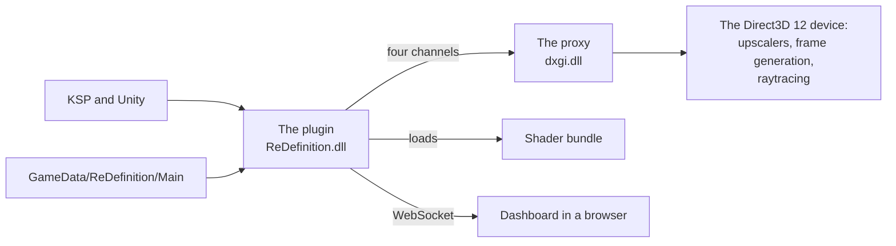
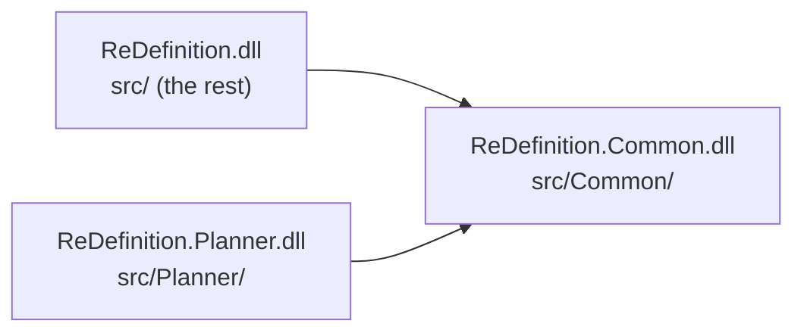
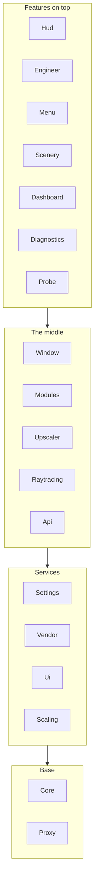

# Architecture

The parts of ReDefinition, what each area of the plugin is for, which area may use which,
and where to read next. The [glossary](../glossary.md) names the terms.

## The parts

ReDefinition is a Kerbal Space Program 1 mod. It has four parts that run and two that support
them.

| Part | Where | Written in | Runs |
|---|---|---|---|
| The plugin | `src/` | C# for KSP's Mono, framework 4.8, language 7.3 | In KSP, as three DLLs: `ReDefinition.dll`, `ReDefinition.Planner.dll` and `ReDefinition.Common.dll` |
| The proxy | `src/DxgiProxy/` | C++ | In KSP's process, as `dxgi.dll` in place of the system's |
| The shaders | `unity/Assets/ReDefinition/` | HLSL and ShaderLab | In Unity, from the bundle `redefinition.shaders` |
| The dashboard | `GameData/ReDefinition/Main/Dashboard/`, served by `src/Dashboard/` | JavaScript | In a browser on a phone or a PC |
| The data | `GameData/ReDefinition/Main/` | KSP config nodes | Read by the plugin and by ModuleManager |
| Tools and tests | `tools/`, `tests/` | Python, PowerShell, C#, C++ | On the developer's machine |

The proxy has its own HLSL, in `src/DxgiProxy/Raytracing/Shaders/`. The build compiles it into
`dxgi.dll`. Only the Unity shaders go into the bundle.

## How the parts talk

The plugin and the proxy share one process. They talk through exported functions, render events
with packets, shared textures and the proxy's ini file. [The four
channels](flow-native-channels.md) describes each one and how it catches a layout that does not
match.

## The areas of the plugin

Each area is a folder under `src/` with a README that says what is in it. The namespace of an
area is `ReDefinition.<Area>`. A subfolder shares it, except `Hud/Panel`, `Hud/Readouts` and
`Settings/Behaviours`, which have namespaces of their own.

| Area | What it is for | Start reading |
|---|---|---|
| (the add-on) | The add-on that starts with the game and runs the rig's life cycle | `src/ReDefinitionAddon.cs` |
| `Api` | The interface other mods call | `src/Api/ApiInfo.cs` |
| `Common` | What both packages stand on: the log, reflection into other mods, optional Harmony hooks, the dialog helpers | `src/Common/HarmonyHooks.cs` |
| `Core` | The paths and the catalogue of what ReDefinition takes for granted about other mods | `src/Core/ForeignAssumptions.cs` |
| `Dashboard` | The web dashboard's server and its telemetry | `src/Dashboard/DashboardServer.cs` |
| `Diagnostics` | The diagnostics window and the report on other mods | `src/Diagnostics/DiagnosticsWindow.cs` |
| `Planner` | The route stack as a mod of its own: the planner, the navigation, the autopilot, the orbit maths and the landing prediction | `src/Planner/PlannerStartup.cs` |
| `Fsr3` | AMD's FSR 3 upscaler, adapted from FSR3Unity | `src/Fsr3/Fsr3Upscaler.cs` |
| `Hud` | Additions to KSP's flight interface, staging stack and time panel | `src/Hud/FlightUiSwitch.cs` |
| `Menu` | Fireworks and the camera flight in the main menu | `src/Menu/MenuFireworks.cs` |
| `Modules` | ReDefinition's own features as modules, and their settings | `src/Modules/OurModules.cs` |
| `Probe` | Measurement runs and test scenes that command-line switches start | `src/Probe/SceneProbe.cs` |
| `Proxy` | The managed half of the proxy: imports, packets, render events | `src/Proxy/ProxyEvents.cs` |
| `Raytracing` | The managed side of raytracing: what the rays see, and the light back | `src/Raytracing/Ksp/RtKsp.cs` |
| `Scaling` | What KSP leaves at a fixed size, scaled to the UI scale | `src/Scaling/ScalingAddon.cs` |
| `Scenery` | Fixes to what the game draws at the space centre and in flight | `src/Scenery/KscGrass.cs` |
| `Settings` | The store, the registrations and the graphics profiles | `src/Settings/BundledSettings.cs` |
| `Ui` | The dialog helpers that only ReDefinition needs: the mouse events, the backdrop, confirmations | `src/Ui/UnityMouseEvents.cs` |
| `Upscaler` | The rig that puts an upscaler on the camera stack | `src/Upscaler/Rig/UpscalerRig.cs` |
| `Vendor` | What the GPU makers need: card class, downloads of their files | `src/Vendor/TechniqueFiles.cs` |
| `Window` | The settings window and the ways to open it | `src/Window/SettingsWindow/SettingsWindow.cs` |

The rest is in the [flow pages](start-here.md#the-flows). The wiki lists every type,
every entry point and every dependency, generated from the code.

## The three assemblies

The plugin is three projects. The dependencies run one way:

| Assembly | Package | Needs |
|---|---|---|
| `ReDefinition.Common.dll` | `GameData/ReDefinition/Common`, the one copy both mods use | KSP and Unity |
| `ReDefinition.Planner.dll` | `GameData/ReDefinition/Planner` | Common. Not ReDefinition, not Harmony, not ZTheme |
| `ReDefinition.dll` | `GameData/ReDefinition/Main` | Common and Harmony. Not the planner |

Neither of the two mods names the other. They meet in Common, and each works without the other:

* **Seams, from ReDefinition to the planner.** `HostSeams` holds what the planner would ask of
  ReDefinition, each with a default that works alone: the interface scale, the two switches for the
  background route and the buttons in the world, whether the planner stands alone, and the space
  centre's button sprites. `HostLink` in `src/` assigns them when ReDefinition starts. Where
  ReDefinition is not there, the planner's `PlannerStartup` answers the two switches from its own
  settings file. Both add-ons start at `Startup.Instantly`, and the result is the same in either
  order.
* **Hooks, from the planner to ReDefinition.** `PlannerHooks` holds what ReDefinition reads of the
  planner: the guidance, the route state, the editor's plan rows, the dry marks of the fuel tapes
  and the planner's assumptions about other mods. Each is an abstract class with virtual defaults in
  Common (`GuidanceHook`, `RouteHook`, `EditorPlanHook`, `DryMarksHook`) and no planner type in any
  signature. The planner's adapters in `src/Planner/Hooks/` fill them in `PlannerStartup` and read
  the live state on every call. Without the planner the hooks stay null, and ReDefinition shows
  nothing of them: no guidance gauge, no burn overlay, no guidance or route keys on the dashboard,
  no dry marks on the tapes.
* **The helpers both use** are in Common: `HeldVessel`, `WarpLabel`, `WorldButton`, `TimeText`,
  `VesselFacts`, `PropellantMix`, `StockNodes`, `ModSettingsFile` (a mod's settings file in its
  `PluginData` folder) and the rest.

Common is one DLL for both, so seams and hooks are shared state. The planner of one release next to
a ReDefinition of another works with the members the Common that the game keeps has. A member added
to a hook later has a virtual default, so an adapter built against an older Common does not break.

`src/ReDefinition.csproj` keeps the planner out of the player build. The developer probes in
`src/Probe` test planner features through its internals, so they are compiled only where
`PlannerProbes` is true, which it is unless `ReleasePackage` is true (or `-p:PlannerProbes=false`).
There the planner project is referenced for the build order only, and `ReDefinition.dll` carries
no reference to it. `tools/checks/check_no_planner_reference.ps1` checks that, and the release
package runs it. Tests keep the rule: only guarded probe files name the planner.

The click shield is in Common too. `WindowShield` and `DialogWindow` are used by both mods, so a
click on a window of either does not reach the buildings, the switches or the map behind it.
ReDefinition adds the windows only it has (`src/Ui/UnityMouseEvents.cs`).

Every zip ships Common in the same place, `GameData/ReDefinition/Common`, so the game holds one
copy and has no duplicate to resolve [src]. A change in `src/Common/` still needs a new
`CommonVersion` in `Directory.Build.props`, and `CommonVersionTests` fails until it has one.
[packaging.md](packaging.md#the-planners-and-commons-packages) says what happens when zips of
different releases are extracted over each other.

The namespaces of the planner are `ReDefinition.Planner.Engineer` (the vessel and stage maths),
`.Planning` (the plan, the route and the budget), `.Ui` (the windows), `.Autopilot`,
`.Autopilot.Driver`, `.Orbits`, `.Landing` and `.Hud`. The table below treats each as an area;
`Planner.Hud` is `PlannerHud`, `Planner.Ui` is `PlannerUi` and `Autopilot.Driver` is `Driver`
there, to tell them from ReDefinition's own and from the rest of the autopilot. A test fails if any
file of the planner or of Common uses more of ReDefinition than `Core` and `Ui`, and another if a
file of `Engineer` uses `Planning`, `Ui` or any `Autopilot` namespace but `Autopilot.Background`.

## Which area may use which

`tests/ReDefinition.Tests/ArchitectureTests.cs` holds a table of what each area uses. A new
dependency that is not in it fails the tests, and so does a table entry that the code no longer
needs. The areas fall into four layers.

The middle layer uses itself in places: `Upscaler` and `Raytracing` name each other, and
`Window` uses `Modules`. The table lists the edges that run against the layers. The most
visible ones are `Modules` naming `Hud`, `Dashboard`, `Scenery` and `Probe` for their settings,
and `Raytracing`, `Upscaler` and `Menu` naming `Probe` for its markers and switches. Remove
these first when you can.

## The proxy

The proxy has its own folders under `src/DxgiProxy/`:

| Folder | What is in it |
|---|---|
| `SwapChain` | The swap chain proxy, and the exports Windows loads the file for |
| `FrameGeneration` | Frame generation: FidelityFX, Streamline and XeSS |
| `Upscalers` | AMD, DLSS, XeSS and NGX, with the NVIDIA GPU detection |
| `Raytracing` | The raytracing passes, with their HLSL in `Shaders` |
| `Latency` | The low latency modes, the brake, the load monitor and the CPU sampler |
| `Managed` | The exports the plugin calls, and Direct3D 12 compute for mods |
| `Diagnostics` | The GPU profiler and the screen recorder |
| `Common` | The configuration, the log and the file helpers |

[The proxy's present path](flow-proxy-present.md) follows a frame through them. The two
harnesses in `tests/DxgiProxy/` run the proxy without the game.

## Where to read next

* [Start here](start-here.md) lists the flows and how-tos in the order to read them.
* [Startup and scenes](flow-startup.md) shows what the game starts and when.
* [Writing code comments](writing-code-comments.md) explains how the developer documentation
  stays true: it is the comments in the code.
