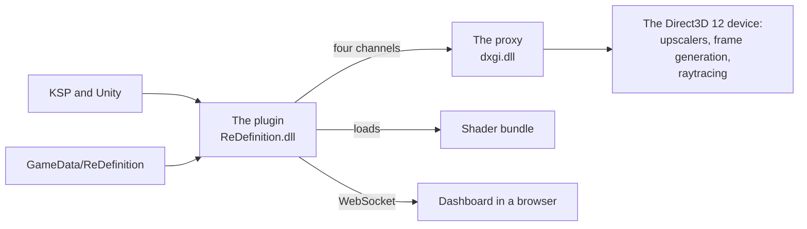
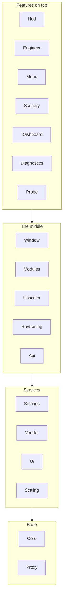

# Architecture

**For:** a developer who is new to the repository, or who changes how its parts fit together.
**You need:** the repository. The [glossary](../glossary.md) names the terms.
**You get:** the parts of ReDefinition, what each area of the plugin is for, which area may use
which, and where to read next.

## The parts

ReDefinition is a Kerbal Space Program 1 mod. It has four parts that run and two that support
them.

| Part | Where | Written in | Runs |
|---|---|---|---|
| The plugin | `src/` | C# for KSP's Mono, framework 4.8, language 7.3 | In KSP, as `ReDefinition.dll` |
| The proxy | `src/DxgiProxy/` | C++ | In KSP's process, as `dxgi.dll` in place of the system's |
| The shaders | `unity/Assets/ReDefinition/` | HLSL and ShaderLab | In Unity, from the bundle `redefinition.shaders` |
| The dashboard | `GameData/ReDefinition/Dashboard/`, served by `src/Dashboard/` | JavaScript | In a browser on a phone or a PC |
| The data | `GameData/ReDefinition/` | KSP config nodes | Read by the plugin and by ModuleManager |
| Tools and tests | `tools/`, `tests/` | Python, PowerShell, C#, C++ | On the developer's machine |

The proxy has its own HLSL, in `src/DxgiProxy/Raytracing/Shaders/`. The build compiles it into
`dxgi.dll`. Only the Unity shaders go into the bundle.

## How the parts talk

The plugin and the proxy share one process. They talk through exported functions, render events
with packets, shared textures and the proxy's ini file. [The four
channels](flow-native-channels.md) describes each one and how it catches a layout that does not
match.

## The areas of the plugin

Each area is a folder under `src/` with a README that says what is in it. The namespace of an
area is `ReDefinition.<Area>`. A subfolder shares it, except `Hud/Panel`, `Hud/Readouts` and
`Settings/Behaviours`, which have namespaces of their own.

| Area | What it is for | Start reading |
|---|---|---|
| (the add-on) | The add-on that starts with the game and runs the rig's life cycle | `src/ReDefinitionAddon.cs` |
| `Api` | The interface other mods call | `src/Api/ApiInfo.cs` |
| `Core` | The log, paths, the command line, reflection into other mods, Harmony hooks | `src/Core/ForeignAssumptions.cs` |
| `Dashboard` | The web dashboard's server and its telemetry | `src/Dashboard/DashboardServer.cs` |
| `Diagnostics` | The diagnostics window and the report on other mods | `src/Diagnostics/ReDefinitionAddon.Diagnostics.cs` |
| `Engineer` | The engineer window of the editors, with the planner | `src/Engineer/EditorEngineer.cs` |
| `Fsr3` | AMD's FSR 3 upscaler, adapted from FSR3Unity | `src/Fsr3/Fsr3Upscaler.cs` |
| `Hud` | Additions to KSP's flight interface, staging stack and time panel | `src/Hud/FlightUiSwitch.cs` |
| `Menu` | Fireworks and the camera flight in the main menu | `src/Menu/MenuFireworks.cs` |
| `Modules` | ReDefinition's own features as modules, and their settings | `src/Modules/OurModules.cs` |
| `Probe` | Measurement runs and test scenes that command-line switches start | `src/Probe/SceneProbe.cs` |
| `Proxy` | The managed half of the proxy: imports, packets, render events | `src/Proxy/ProxyEvents.cs` |
| `Raytracing` | The managed side of raytracing: what the rays see, and the light back | `src/Raytracing/Ksp/RtKsp.cs` |
| `Scaling` | What KSP leaves at a fixed size, scaled to the UI scale | `src/Scaling/ScalingAddon.cs` |
| `Scenery` | Fixes to what the game draws at the space centre and in flight | `src/Scenery/KscGrass.cs` |
| `Settings` | The store, the registrations and the graphics profiles | `src/Settings/BundledSettings.cs` |
| `Ui` | The helpers every ReDefinition dialog is built with | `src/Ui/UiHygiene.cs` |
| `Upscaler` | The rig that puts an upscaler on the camera stack | `src/Upscaler/Rig/UpscalerRig.cs` |
| `Vendor` | What the GPU makers need: card class, downloads of their files | `src/Vendor/TechniqueFiles.cs` |
| `Window` | The settings window and the ways to open it | `src/Window/SettingsWindow/SettingsWindow.cs` |

The rest is in the [flow pages](start-here.md#the-flows). The wiki lists every type,
every entry point and every dependency, generated from the code.

## Which area may use which

`tests/ReDefinition.Tests/ArchitectureTests.cs` holds a table of what each area uses. A new
dependency that is not in it fails the tests, and so does a table entry that the code no longer
needs. The areas fall into four layers.

The middle layer uses itself in places: `Upscaler` and `Raytracing` name each other, and
`Window` uses `Modules`. The table lists the edges that run against the layers. The most
visible ones are `Modules` naming `Hud`, `Dashboard`, `Scenery` and `Probe` for their settings,
and `Raytracing`, `Upscaler` and `Menu` naming `Probe` for its markers and switches. Remove
these first when you can.

## The proxy

The proxy has its own folders under `src/DxgiProxy/`:

| Folder | What is in it |
|---|---|
| `SwapChain` | The swap chain proxy, and the exports Windows loads the file for |
| `FrameGeneration` | Frame generation: FidelityFX, Streamline and XeSS |
| `Upscalers` | AMD, DLSS, XeSS and NGX, with the NVIDIA GPU detection |
| `Raytracing` | The raytracing passes, with their HLSL in `Shaders` |
| `Latency` | The low latency modes, the brake, the load monitor and the CPU sampler |
| `Managed` | The exports the plugin calls, and Direct3D 12 compute for mods |
| `Diagnostics` | The GPU profiler and the screen recorder |
| `Common` | The configuration, the log and the file helpers |

[The proxy's present path](flow-proxy-present.md) follows a frame through them. The two
harnesses in `tests/DxgiProxy/` run the proxy without the game.

## Where to read next

* [Start here](start-here.md) lists the flows and how-tos in the order to read them.
* [Startup and scenes](flow-startup.md) shows what the game starts and when.
* [Writing code comments](writing-code-comments.md) explains how the developer documentation
  stays true: it is the comments in the code.
