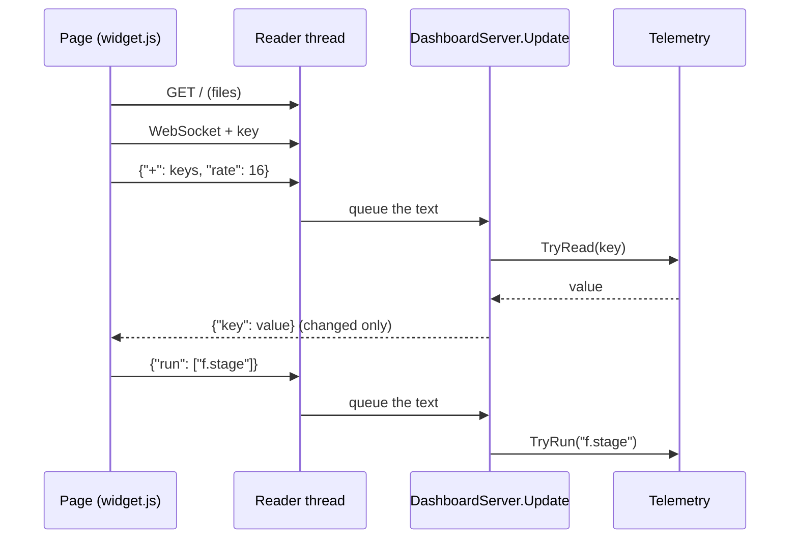

# The dashboard

**For:** a developer who adds a reading or a command to the dashboard, or changes how it
connects.
**You need:** the repository, and a phone, a browser or an iCUE touch screen to look at it.
**You get:** the path of one telemetry value from the game to a page, and of one command back.

The dashboard is a set of web pages for a phone, a browser or a Corsair iCUE touch screen. The
mod serves the pages and one WebSocket from the same port. Text travels both ways as JSON:
the page names the keys it wants, the mod sends the ones whose value changed, and the page
sends commands. Read this page to find out where a key lives, or to add one.

## The path of a value

1. `src/Dashboard/DashboardServer.cs` is a `[KSPAddon(KSPAddon.Startup.Instantly, true)]`.
   `DashboardServer.Awake` keeps it across scenes and builds the `Telemetry`.
2. `DashboardServer.Update` starts the server on `DashboardServer.Port` (8765). It listens on
   127.0.0.1 only, or on every interface when `OwnSettings.DashboardNetwork` is set. A changed
   setting or key starts the server again (`DashboardServer.Listen`).
3. The page loads from `GameData/ReDefinition/Dashboard`. `WebSocketServer.ServeFile` answers a
   plain `GET` with `index.html` or a file of the types in `WebSocketServer.ContentTypes`.
   The files need no key, and nothing outside the folder is served.
4. `index.html` loads `navball.js`, `pages.js`, `menu.js`, `ksc.js`, `editor.js` and
   `widget.js`. `connect` in `widget.js` opens `ws://<host>/?key=...` when a browser served the
   page, and `ws://localhost:8765/` in iCUE.
5. `WebSocketServer.Handshake` decides who gets in. A request with the dashboard key in its
   query is accepted. Without the key, only a client on this computer with no origin, the
   origin `null` or a `file://` origin is accepted (`WebSocketServer.OriginAllowed`).
6. An accepted connection becomes a `WebSocketServer.Client` with its own reader and writer
   thread. `DashboardServer` gives it a `DashboardServer.Subscriptions` as `Client.State`.
7. The page sends `{"+": [keys], "rate": 16}`. The reader thread queues the text, and
   `DashboardServer.Handle` reads it in the next `Update`. `+` and `-` change the subscribed
   keys, `run` lists commands and one-shot reads, and `rate` sets the milliseconds between
   updates.
8. Once a client's interval is up, `DashboardServer.Collect` asks `Telemetry.TryRead` for each
   key. `Telemetry.Round` rounds the value to what the page shows.
9. A value goes out only when its JSON text differs from the one last sent. `Json.Encode`
   writes the object, and `Client.SendText` queues it for the writer thread.
10. `widget.js` merges each message into `data` and draws from it. A command goes the other way
    as `{"run": ["f.stage"]}` through `Dashboard.run`. `DashboardServer.Run` hands it to
    `Telemetry.TryRun`, on the main thread.

## Where a key lives

`Telemetry` holds four tables, filled in its constructor.

* `readers` and `actions` belong to the active vessel. `Telemetry.TryRead` and
  `Telemetry.TryRun` use them only in flight and while the game is not paused
  (`Telemetry.PauseState` is 0).
* `sceneReaders` and `sceneActions` work in every scene. They are the keys of the menu, the
  game, the space centre and the editors.
* The scene tables call the `*Telemetry` classes: `MenuTelemetry`, `GameTelemetry`,
  `KscTelemetry`, `EditorTelemetry` and `FuelTelemetry`. Some keep state between reads.
* A key may carry arguments in brackets, `r.resource[LiquidFuel]`. `Telemetry.Split` cuts them
  at the commas. The key names follow Telemachus' API.

## Add a telemetry value

1. Add a reader in the `Telemetry` constructor: `readers["v.name"]` for the vessel, or
   `sceneReaders["g.name"]` for a scene key. Put code of more than a line in the matching
   `*Telemetry` class.
2. For a number, add its step to `Telemetry.Steps` in the static constructor. Without a step
   the value goes out unrounded, and it is sent again on every tiny change.
3. For a command, add `actions[...]` or `sceneActions[...]` the same way. It runs on the main
   thread, so it may touch the game.
4. Ask for the key in the browser. A flight key goes into the list in `subscription` in
   `GameData/ReDefinition/Dashboard/scripts/widget.js`. A scene page lists its keys in its own
   `KEYS`, in `menu.js`, `ksc.js` or `editor.js`.
5. Read it from `data["your.key"]` in the page's `render`. Send a command with
   `window.Dashboard.run("your.command[1]")`.
6. Hold the new key in a test in `tests/ReDefinition.Tests`, for example in
   `EditorTelemetryTests.TheEditorsKeysAndCommandsAreKnownInEveryScene`, which calls
   `Telemetry.IsKnown`.

## The iCUE widget

`GameData/ReDefinition/Dashboard/manifest.json` makes the folder an iCUE widget. Its
`permissions` name port 8765, which is the reason the port is fixed. The build packs the folder
into `ksp-dashboard.icuewidget` (the `PackageIcueWidget` target in `src/ReDefinition.csproj`).
`tools/icuewidget/package.json` only validates the folder: run `npm install` and
`npm run validate` there. iCUE passes its settings to `widget.js` through `icueEvents`.

## Where to change it

* A new key or command: the `Telemetry` constructor, or the `*Telemetry` class of its scene.
* How the page looks and which keys it asks for: `widget.js` for the flight panels, and
  `menu.js`, `ksc.js` and `editor.js` for the scene pages. Their styles are in `styles/`.
* Who may connect, which files are served and the update rate: `WebSocketServer.Handshake`,
  `WebSocketServer.ServeFile` and `DashboardServer.Handle`.

## What can go wrong

* Another program holds port 8765. The log says `[ReDefinition] Dashboard: could not listen on
  port 8765: ...`, and the server is not tried again until a setting changes.
* A browser tab of a website asks for the socket. The server refuses it and logs `refused
  origin ...`. A page from another computer needs the key in the address.
* A key the mod does not know. `DashboardServer.Collect` lists it under `unknown` in the
  update. No script reads `unknown`, so the page shows nothing for it.
* A reader throws, for example for a part that vanished in the frame. The log says
  `reading <key> failed: ...`, and the server drops that key from the client's subscription.
* A command fails. The log says `command <name> failed: ...`, and the rest of the list runs.
* A client reads too slowly. `Client.EnqueueFrame` keeps two text frames and sets
  `Client.Dropped`; the next update sends every key again.
* A message that is not JSON is logged as `bad message: ...`.
* A vessel key outside flight, or while the game is paused, has no value. The page keeps its
  last one, because `Telemetry.TryRead` returns false and the server sends nothing.
