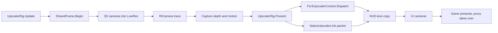

# A frame in the mod

**For:** a developer who changes what the mod does between KSP's cameras and the screen.
**You need:** the repository, and the glossary for the rig, the presenter and the HUD-less
copy.
**You get:** the order in which the mod's C# side handles one rendered frame, and the file that
does each step.

One frame travels from the scene's cameras to the frame buffer in three parts. The 3D cameras
render at the render size into a texture of the rig. The upscaler turns that texture into the
display-size image. The UI cameras then draw on top. Read this page to find out which step owns
a piece of data before you change it. What happens in the proxy after the frame is out is in
[the native channels](flow-native-channels.md).

## The steps of a frame

The rig is built once, before the first frame. `ReDefinitionAddon.TryAttach` adds an
`UpscalerRig` to the scene camera. `UpscalerRig.Setup` makes the textures
(`UpscalerTextures.Make`), redirects the cameras (`UpscalerCameras.Redirect`), attaches the
capture (`UpscalerInputs.AttachCapture`) and starts the upscaler (`UpscalerRig.StartUpscaler`).
Then each frame runs in this order:

1. `UpscalerRig.Update` in `src/Upscaler/Rig/UpscalerRig.cs` asks for a rebuild when a texture,
   the screen size or the camera's HDR changed. It records the inputs
   (`UpscalerRig.RecordInputs`) and picks this frame's jitter (`UpscalerRig.ChooseJitter`).
   `UpscalerRig.SetupDispatch` then fills the dispatch description from the rig's textures.
2. `SharedFrame.OnPreCull` in `src/Api/Internal/SharedFrame.cs` begins the frame when the first
   camera of the stack culls. `SharedFrame.Begin` asks `HistoryResets.Begin` and
   `CameraCuts.Detect` for a reset, sums the origin shifts, copies the sizes and the jitter
   from the rig, sets the `_ReDefinition_*` shader globals and calls the mods' reset handlers.
3. Every camera in `UpscalerCameras.SceneCameras` renders into `UpscalerTextures.LowRes`,
   because `CameraRedirect.Redirect` gave it that target. In `CameraRedirect.OnPreRender`,
   `CameraRedirect.ApplyJitter` adds `CameraRedirect.JitterNdc` to the projection.
   `CameraRedirect.OnPostRender` takes it off again.
4. `UpscalerRig.OnPreCull` in `src/Upscaler/Rig/UpscalerRig.Hooks.cs` runs on the scene camera.
   It samples the distant planets and the clouds (`ScaledSpaceMotion.Sample`,
   `CloudMotionVectors.Sample`). It adds the vessel's depth and motion vectors
   (`VesselMotionVectors.RecordDepth`, `VesselMotionVectors.RecordRepair`) to the capture. Then
   it calls the mods' motion vector hooks (`UpscalerRig.RecordMotionVectorHooks`).
5. When raytracing is on, `RtCamera.OnPreRender` in `src/Raytracing/RtCamera.cs` runs
   `RtCamera.TraceThisFrame`. First `RtCamera.BeforeTrace`, set by `RtKsp`, makes
   `CameraRedirect.EnsureJitter` apply the jitter. The trace sits at
   `CameraEvent.BeforeReflections`, or at `CameraEvent.AfterDepthTexture` without a G-buffer.
   Both come before the lighting, so the lighting reads this frame's rays.
6. The capture buffer `UpscalerInputs.Capture` runs at `CameraEvent.BeforeImageEffects`. It
   copies the depth into `UpscalerTextures.DepthCopy` and the motion vectors, with the clouds
   and the distant planets blended in, into `UpscalerTextures.MotionVectors`
   (`UpscalerInputs.Record`).
7. `UpscalerPresenter.OnRenderImage` in `src/Upscaler/Rig/UpscalerPresenter.cs` calls
   `UpscalerRig.Present` with the frame buffer as the destination. The presenter camera sits
   behind the stack and draws nothing itself.
8. `UpscalerRig.Present` decides the history reset for this frame (`SharedFrame.LateReset`) and
   tells the proxy whether frame generation is on (`FrameGenerationBridge.SetEnabled`). With
   FSR 3 it records `Fsr3UpscalerContext.Dispatch` into `UpscalerRig.dispatchBuffer`.
9. With DLSS, AMD's DLL or XeSS, `UpscalerRig.SubmitNative` in
   `src/Upscaler/Rig/UpscalerRig.Native.cs` fills a packet and calls `DlssBridge.Submit`,
   `AmdUpscalerBridge.Submit` or `XessUpscalerBridge.Submit`. Each goes through
   `NativeUpscalerLink.Submit` into the same buffer. `UpscalerRig.SubmitReconstruction` sends
   DLSS Ray Reconstruction's packet instead when raytracing supplies the guides.
   `RcasSharpener.Schedule` then sharpens the proxy's output.
10. `UpscalerRig.SubmitFramePacket` appends frame generation's packet. `Present` runs the
    buffer (`Graphics.ExecuteCommandBuffer`), then `UpscalerRig.RunAfterUpscalingHooks`, then
    TUFX's effects after the upscaler (`TufxPostProcessing.Render`) or a plain `Graphics.Blit`.
11. The HUD-less copy is `UpscalerRig.hudLessBuffer`, recorded by
    `UpscalerRig.RecordHudLessCopy`. It runs at `CameraEvent.AfterEverything` on the presenter
    and on `FXCamera` and `FXDepthCamera` (`UpscalerRig.HudLessCarriers`). It copies the frame
    buffer into `UpscalerTextures.HudLess`.
12. `UpscalerOverlay.OnPreCull` calls `UpscalerRig.FillOverlay`, which runs the mods' overlay
    hooks. The overlay camera exists only while a hook is registered.
13. The UI cameras and the `OnGUI` windows draw last. They are not in
    `UpscalerCameras.SceneCameras`, so they render at full size straight into the frame buffer,
    after the HUD-less copy. `ScreenCoordinates` keeps the cursor and the markers right for the
    smaller texture the stack drew into.

## Where to change it

* A new kind of motion vector or depth for the upscalers: `UpscalerInputs.Record` and the
  writers in `src/Upscaler/MotionVectors/`. Another mod does the same through
  `Hooks.RegisterMotionVectors` ([the interface for other mods](flow-mod-interface.md)).
* A new upscaler technique: add it to `UpscalerBackend` and `UpscalerBackends.Link` in
  `src/Proxy/NativeUpscalerLink.cs`, and give `UpscalerRig.SubmitNative` its packet.
* The cameras the rig redirects or copies: `UpscalerCameras.SceneCameras` for the stack,
  `UpscalerRig.EffectCameras` for the cameras the HUD-less copy waits for.

## What can go wrong

* A render texture is lost, the window is resized or the camera's HDR flips.
  `UpscalerRig.RequestRebuild` logs `[ReDefinition] Rebuilding the upscaler: <reason>.` Until
  the add-on builds the new rig, `Present` shows the rendered image without upscaling
  (`UpscalerRig.PresentsRendered`).
* The rig cannot be set up, for example `No 3D cameras found to redirect.` The add-on logs
  `The upscaler could not be set up` with that reason and tries again.
* The proxy is missing, older than the mod, or has no such technique.
  `ReDefinitionAddon.TryAttach` logs `<technique> cannot run, FSR 3 runs instead: <reason>`.
* A technique in the proxy stops while it runs. `UpscalerRig.NoteNativeState` logs
  `<technique> stopped, the image is shown without upscaling: <reason>`. After one second, or
  two once it had shown frames, it rebuilds the rig with FSR 3
  (`Rebuilding the upscaler: ... FSR 3 runs instead`). A failure that stands rebuilds at once.
* The camera cuts. `SharedFrame.Begin` logs `History reset: <reason>.` A cut found while the
  frame renders logs `History reset while the frame rendered: <reason>.`
* A camera draws after the HUD-less copy. `UpscalerRig.LogHudLessCapture` lists it in the
  `HUD-less snapshot at the end of` line. A post-processing layer there adds a `[WARNING:`,
  because frame generation then takes the whole image for UI.
* A mod's hook throws. `HookList<T>.Invoke` removes it and logs
  `A handler registered for <hook> threw and is removed`.
* The packet layouts of mod and proxy differ. The log lines are in [the native
  channels](flow-native-channels.md).
