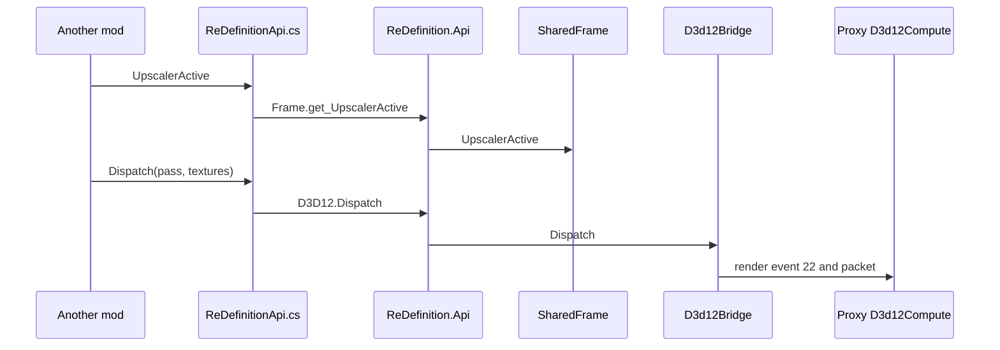

# The interface for other mods

**For:** a developer who changes `ReDefinition.Api`, or who has to know what a call from
another mod does.
**You need:** the repository, and the modder pages open for the author's side.
**You get:** where each member of the interface gets its answer, how another mod finds it, and
how its Direct3D 12 calls reach the proxy.

Other mods read ReDefinition's frame state, add commands to its frame, follow its profile and
run compute passes on its Direct3D 12 device. They do it through `ReDefinition.Api`, a facade
of six static classes in `src/Api/`. The facade keeps almost nothing itself. It forwards to
`src/Api/Internal/` and to the rest of the mod. Read this page to see where an answer comes
from. The author's side is in [modders/shared-foundation.md](../modders/shared-foundation.md),
and the design in [shared-foundation.md](shared-foundation.md).

## What the facade forwards to

* `ApiInfo.Version` is `SharedFrame.InterfaceVersion`. It rises with every change of the
  interface, and the shader global `_ReDefinition_Frame` carries it as its fourth value.
* `Frame` in `src/Api/Frame.cs` reads the properties of `SharedFrame` in
  `src/Api/Internal/SharedFrame.cs`. `Frame.RequestHistoryReset` and the reset handlers go to
  `HistoryResets` and a `HookList`.
* `Hooks` in `src/Api/Hooks.cs` adds handlers to the `HookList` fields of `SharedFrame`. The
  rig calls them. `HookList.Invoke` runs each one on its own, so a throwing handler cannot stop
  the others.
* `Profiles` in `src/Api/Profiles.cs` reads `SharedFrame.Profile`, which
  `SharedFrame.PollProfile` sets from the settings store once per `Update` of the add-on.
* `Keys` in `src/Api/Keys.cs` asks the settings store (`BundledSettings.Find`) for the binding.
  It answers false while a text field has the keyboard (`Keys.Blocked`).
* `D3D12` in `src/Api/D3D12.cs` forwards to `D3d12Bridge` in `src/Proxy/D3d12Bridge.cs`.

Every member takes and returns types of .NET, Unity and KSP only. The layering test
`ArchitectureTests` lets `Api` depend on `Core`, `Proxy`, `Settings`, `Ui`, `Upscaler` and
`Window`, and `Upscaler` depend on `Api`.

## How another mod finds it

A mod that copies `docs/modders/examples/ReDefinitionApi.cs` needs no reference to
`ReDefinition.dll`. The example looks the interface up by name.

1. `ReDefinitionApi.Resolve` scans `AppDomain.CurrentDomain.GetAssemblies()` for an assembly
   named `ReDefinition` that has the type `ReDefinition.Api.ApiInfo`. KSP loads assemblies one
   after another, so it looks again at most once a second until it finds one.
2. It reads the constant `ApiInfo.Version` with `GetRawConstantValue`. A version below
   `ReDefinitionApi.WrittenFor` binds nothing, and every member returns its fallback.
3. `ReDefinitionApi.Bind` looks up each member by type name and method name, for example
   `Frame` and `get_UpscalerActive`. It turns the method into a typed delegate with
   `Delegate.CreateDelegate`.
4. A member the installed version lacks is left null and named in
   `ReDefinitionApi.MissingMembers`. Its wrapper returns the value the game has without
   ReDefinition.

The names are therefore part of the interface.
`tests/ReDefinition.Tests/SharedFoundationTests.cs` compiles the example into the test project.
`TheWrapperFindsEveryMemberOfTheInterface` fails when a member it binds was renamed or removed.
`ReadingTheFrameThroughTheWrapperAllocatesNothing` fails when a read starts to allocate.

## How a frame reaches a mod

1. `SharedFrame.Install`, called from the add-on's `Awake`, subscribes `SharedFrame.OnPreCull`
   to `Camera.onPreCull` and the floating origin's event.
2. When the first camera of the stack culls, `SharedFrame.Begin` sets the properties that
   `Frame` reads and the `_ReDefinition_*` globals that `ReDefinition.cginc` declares. A mod
   that reads them in `Update` sees the previous frame's.
3. A history reset requested before `Begin` reaches every mod in that frame. One found while
   the frame renders resets the upscaler at once and reaches the mods in the next frame
   (`SharedFrame.LateReset`).
4. The rig calls the hooks at fixed places: `UpscalerRig.RecordMotionVectorHooks`,
   `UpscalerRig.RunAfterUpscalingHooks` and `UpscalerRig.FillOverlay`. [A frame in the
   mod](flow-frame.md) shows where they sit.

## Direct3D 12 compute from a mod

Unity renders in Direct3D 11, so a pass runs on shared copies of the textures. The calls of
`D3D12` reach the proxy through [the render-event channel](flow-native-channels.md).

1. `D3D12.CreateComputePassFromSource` or `CreateComputePassFromFile` compiles through
   `D3d12Bridge.Compile`. That calls `KspD3d12Compile`, which runs `CompileComputeShader` with
   Windows' `d3dcompiler_47.dll`. `D3D12.CreateComputePass` takes bytecode directly.
2. `D3d12Bridge.CreateComputePass` copies the bytecode to unmanaged memory and raises render
   event 20. `D3d12Compute::OnCreatePass` builds the pipeline on the render thread, or at the
   first dispatch when the proxy has no device yet. `D3D12.ComputePassState` reads the result
   through `KspD3d12PassStatus`.
3. `D3D12.Dispatch` and `D3D12.DispatchInto` call `D3d12Bridge.Dispatch`. It checks the limits,
   takes each texture's native pointer and sends a `DispatchPacket` through `PacketRing` as
   event 22. `DispatchInto` records the event into the mod's buffer, and `Dispatch` executes it
   at once.
4. `D3d12Compute::OnDispatch` in `src/DxgiProxy/Managed/D3d12Compute.cpp` copies the textures
   into shared copies and signals a fence. The Direct3D 12 queue waits on it and runs the pass.
   The results are copied back into Unity's textures, or at the pass's next dispatch with
   `nextFrame`.
5. `D3D12.ReleaseTexture` and `D3D12.DestroyComputePass` raise events 23 and 21.

## Where to change it

* A new member: add it to its class in `src/Api/`, add its binding to
  `docs/modders/examples/ReDefinitionApi.cs`, raise `SharedFrame.InterfaceVersion`, and set
  `ReDefinitionApi.WrittenFor` in the example to the new value.
* A new hook: add a `HookList` to `SharedFrame`, a `Register` and an `Unregister` method to
  `Hooks`, and the call in the rig, in `src/Upscaler/Rig/UpscalerRig.Hooks.cs`.
* A limit of the compute service: `D3d12Bridge.MaxTextures`, `D3d12Bridge.MaxConstants` and
  `D3d12Bridge.MaxDispatchesPerFrame` on the mod's side, `kD3d12MaxTextures` and
  `kD3d12MaxConstants` in `D3d12Compute.h` on the proxy's.

## What can go wrong

* ReDefinition is missing or older than the example. `ReDefinitionApi.Installed` is false, and
  every member returns its fallback. `MissingMembers` names what the installed version lacks.
* A handler throws. `HookList.Invoke` removes it and logs
  `A handler registered for <hook> threw and is removed` with the handler's type and assembly.
* Direct3D 12 is not there. `D3D12.Problem` says why: the proxy is missing or older
  (`D3d12Bridge.NotInstalled`), the packets disagree (`disagree on the Direct3D 12 packets`),
  or the proxy runs with `enabled=0` or `measureOnly=1`.
* A call is refused. `D3D12.LastRefusal` says, for example,
  `more than 32 dispatches in one frame` or that a texture is not a created `RenderTexture`.
* A pass fails on the render thread. `D3D12.ComputePassState` returns -1, and
  `ReDefinitionProxy.log` has a `Direct3D 12 for mods, pass <n>:` line. A rejected packet logs
  `Direct3D 12 for mods: a dispatch packet rejected`.
* A shader does not compile. `D3D12.LastCompilerMessages` holds the compiler's errors.
