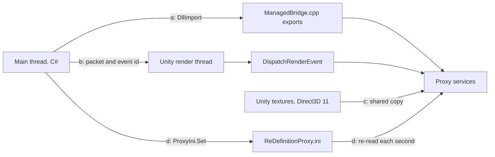

# The four channels to native code

**For:** a developer who changes what the C# mod and the proxy tell each other.
**You need:** the repository. The proxy is `src/DxgiProxy/`, the mod's side of it `src/Proxy/`.
**You get:** the four ways data crosses into the proxy, who owns the layout of each, and what
tells you when mod and proxy disagree.

The mod runs in KSP's process, and the proxy is the `dxgi.dll` that process loaded, so the two
share an address space. Four channels connect them. Read this page before you add an export, a
packet field or an ini key, because each channel catches a mismatch in its own way.

| Channel | Direction | Carrier | Who owns the layout | How a mismatch is caught |
|---|---|---|---|---|
| (a) exports | mod to proxy, main thread | `DllImport("dxgi.dll")` of the `Ksp*` functions | the C signature in `src/DxgiProxy/Managed/ManagedBridge.cpp` | a missing name throws `EntryPointNotFoundException`; structures are size-checked |
| (b) render events | mod to proxy, render thread | a struct in a `PacketRing` slot, sent with `IssuePluginEventAndData` | the native header; the C# struct copies it | the proxy checks size and magic; the mod checks the size first; tests pin both |
| (c) shared textures | Unity's Direct3D 11 to the proxy's Direct3D 12 | a texture's native pointer, then a shared copy made by the proxy | Unity's texture; the proxy builds the copy from its description | the proxy logs a texture it cannot share; the rig is rebuilt when one is lost |
| (d) the ini | the player or the mod to the proxy | `ReDefinitionProxy.ini` | `ProxyConfig` in `src/DxgiProxy/Common/Config.h` and the ini template | it is not caught: an unknown key does nothing |

## (a) Exports the mod calls

`ProxyDll.Name` in `src/Proxy/ProxyDll.cs` is `dxgi.dll`. Every bridge in `src/Proxy/` imports
its `Ksp*` functions from it, so the mod needs no file of its own. The proxy exports them from
`src/DxgiProxy/Managed/ManagedBridge.cpp` inside `extern "C"`.

Calls with scalar arguments, such as `KspFgSetEnabled`, run on the main thread. Raytracing
hands over a structure by pointer (`KspRtSetMesh`, `KspRtSetInstances`). The proxy copies it
before the call returns. `RtNative.Ready` first asks `KspRtStructSizes` for the sizes of those
structures and compares them with `Marshal.SizeOf`.

An export keeps its name for as long as its arguments do. When they change, it gets a new name:
`KspFgRegisterInputs3` and `KspDlssRenderSizes2` are such names. A mod built for the old
arguments then fails to find the entry point and switches the feature off, instead of passing
one texture as another.

## (b) Packets in render events

A packet describes one frame, so it has to reach the proxy with that frame. The main thread
runs ahead of the render thread, which is why a plain call would arrive too early. The steps:

1. The bridge fills a packet struct and sets `Size` and `Magic`, for example in
   `DlssBridge.Submit` or `FrameGenerationBridge.SubmitFrame`.
2. `PacketRing.Issue` in `src/Proxy/PacketRing.cs` copies the struct into the next of its slots
   with `Marshal.StructureToPtr`. It records `CommandBuffer.IssuePluginEventAndData` with the
   proxy's callback, from `KspFgGetRenderEventFunc`, the event id and the slot.
3. Unity runs the buffer. On its render thread it calls `OnRenderEvent`, which calls
   `DispatchRenderEvent` in `ManagedBridge.cpp`. That function picks the handler by id.
4. The handler, for example `Dlss::OnPacket`, `FrameGeneration::OnFramePacket`,
   `Raytracing::OnFrame` or `D3d12Compute::OnDispatch`, compares `size` and `magic` with its
   own struct and rejects the packet on a difference.

The ids live in `src/DxgiProxy/Managed/ProxyContract.h`, which `ProxyEvents` in
`src/Proxy/ProxyEvents.cs` copies. The raytracing ids and every raytracing layout live in
`src/DxgiProxy/Raytracing/Shaders/RtContract.h`, which `RtNative` copies. `ProxyContractTests`
and `RtContractTests` in `tests/ReDefinition.Tests` read those headers and compare ids, flags,
field offsets and sizes with the C# side. `DlssPacketLayoutTests` and `FramePacketLayoutTests`
pin the other packets to numbers.

Before its first packet, `NativeUpscalerLink.Ready` asks the proxy for its packet size. A slot
is never freed, because the render thread may still read it after the rig is gone.

## (c) Textures both devices see

Unity renders in Direct3D 11. Frame generation, raytracing, AMD's upscaler, XeSS and the
Direct3D 12 passes of mods run on the proxy's Direct3D 12 device. The mod hands over a
`RenderTexture` by `GetNativeTexturePtr`, in a packet or in
`FrameGenerationBridge.RegisterInputs`.

`SharedTexture::Create` in `src/DxgiProxy/FrameGeneration/FrameGenerationInputs.cpp` makes a
texture on Unity's device with an NT handle and opens it on the Direct3D 12 device. The proxy
then copies Unity's texture into it, flipped where the format allows
(`FrameGeneration::CopyInputLocked`). For frame generation that copy happens at Present
(`FrameGeneration::CaptureForPresent`). `Raytracing::SharedForLocked` in
`src/DxgiProxy/Raytracing/RaytracingDevice.cpp` keeps one shared copy per Unity texture and
waits on a fence made by `SharedFence` so the two devices do not touch it together. DLSS needs
no copy, because it runs on Unity's own device.

## (d) The ini

`ReDefinitionProxy.ini` sits beside `KSP_x64.exe`. The proxy writes it from a template built
into `dxgi.dll` when there is none, and adds the keys a newer version brings (`CompleteIni` in
`src/DxgiProxy/Common/Config.cpp`). `LoadConfig` reads it at the start. `ReloadConfigIfChanged`
reads it again from the present path, at most once a second, when its write time changed. A key
under the `live` marker applies at once. The keys above it apply at the next start, and those
below it when what they serve starts. The mod writes a few keys through `ProxyIni.Set` in
`src/Proxy/ProxyIni.cs`, such as `frameGenerationTechnique` and `lowLatency`. `KspFgConfigured`
tells the mod whether the proxy has frame generation switched on.

## Where to change it

* A new export: write it in `ManagedBridge.cpp` and its `DllImport` in the matching bridge in
  `src/Proxy/`. Rename it when its arguments change.
* A new packet field or event: change the native header and its `static_assert`, the C# struct
  and the pinned numbers or the contract header. Add an event id to `ProxyContract.h`,
  `ProxyEvents` and `DispatchRenderEvent`.
* A new ini key: add it to `src/DxgiProxy/ReDefinitionProxy.ini` under the right marker and to
  `ProxyConfig` and its reader in `Config.cpp`.

## What can go wrong

* The proxy is not there, is older than the mod, or Windows refused it. The first call throws
  `DllNotFoundException` or `EntryPointNotFoundException`. `NativeUpscalerLink.NotInstalled`
  says `needs ReDefinition's dxgi.dll proxy next to KSP_x64.exe`. `ProxyLoad.Refused` warns
  first when Windows refused the file.
* A packet has another size. The mod logs `disagree on the <technique> packet`,
  `Frame packet layout mismatch` or `the proxy's raytracing structures differ`, and the feature
  stays off.
* The sizes agree but a field moved. The proxy rejects the packet by its magic. It logs
  `Frame packet rejected: size`, `DLSS frame packet rejected`, `Raytracing: a frame rejected`
  or `a dispatch packet rejected` in `ReDefinitionProxy.log`.
* An event id the proxy does not know. `DispatchRenderEvent` drops it without a line.
* A handler throws. `OnRenderEvent` logs `Render event <id> ended in an exception` for the
  first ten.
* A texture cannot be shared. The proxy logs `Shared input texture failed` or
  `format <n> cannot be shared`. Frame generation also logs `HUD-less texture is` when its size
  differs from the display's.
* A key is misspelled or only read at start. Nothing fails. Look for the `Config reloaded:`
  line in `ReDefinitionProxy.log`, which lists what applied and what applies later.
