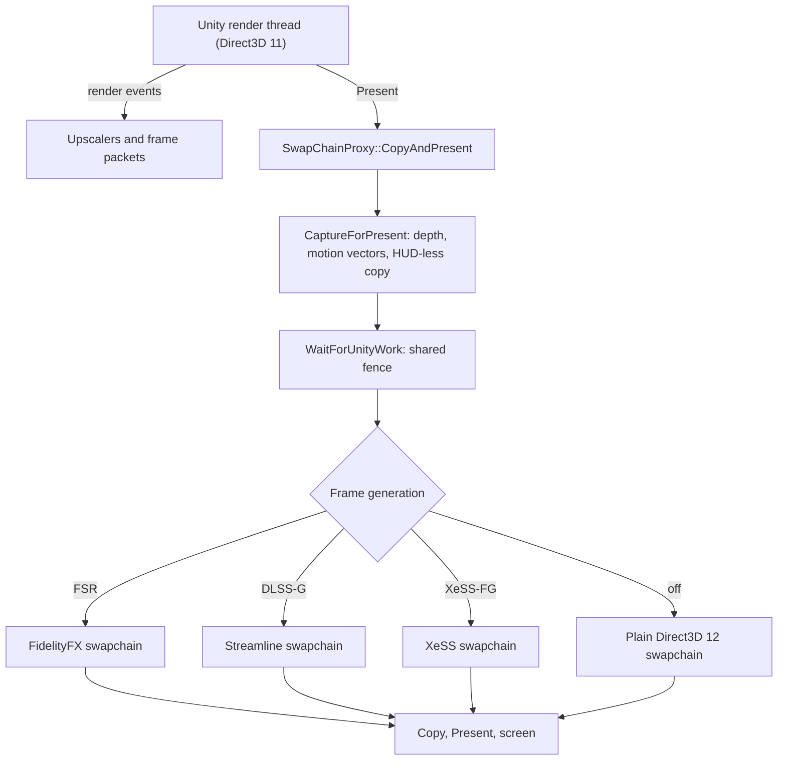

# The proxy's present path

**For:** anyone changing what happens between KSP's `Present` call and the screen.
**You need:** `src/DxgiProxy` open, and a `ReDefinitionProxy.log` from a run to compare with.
**You get:** the route of one frame through the proxy, which file does each step, and where
the proxy logs.

Unity draws KSP on Direct3D 11 and never knows the proxy is there. The proxy hands Unity a
texture to draw into, copies that texture into a Direct3D 12 swapchain, and presents it
there. Frame generation, the upscalers and the low latency modes all attach to that
copy. Read this page to find the file that owns a step before you change it.

## The route of a frame

1. Windows loads the proxy's `dxgi.dll` from KSP's folder in place of its own. `DllMain` in
   `src/DxgiProxy/SwapChain/DxgiExports.cpp` opens the log with `LogOpen`, reads
   `ReDefinitionProxy.ini` with `LoadConfig` and tells `LoadMonitor::SetAllowed` whether the
   proxy is on.
2. Unity calls `CreateDXGIFactory1`, or one of its two siblings. Each export loads the
   system `dxgi.dll` through `RealProc` and passes the factory to `HookIfFactory`. That
   patches entry 15 of the shared vtable, `CreateSwapChainForHwnd`, once.
3. Unity creates its swapchain. `HookedCreateSwapChainForHwnd` records the adapter with
   `NoteSwapChainAdapter` and calls `SwapChainProxy::Create`. Any failure falls through to
   the system's own call, so the game still starts.
4. `SwapChainProxy::Initialise` in `src/DxgiProxy/SwapChain/SwapChainProxy.cpp` makes the
   Direct3D 12 device on Unity's adapter. `CreatePresentationSwapChain` then picks the
   swapchain: Streamline's, XeSS-FG's, FidelityFX's or a plain one.
5. `SwapChainProxy::CreateSharedColour` in `SwapChainProxyBuffers.cpp` makes one texture on
   the Direct3D 11 device and opens it on the Direct3D 12 one. `SwapChainProxy::GetBuffer`
   hands that texture to Unity as its backbuffer.
6. Unity renders. The mod raises render events on Unity's render thread, and
   `DispatchRenderEvent` in `src/DxgiProxy/Managed/ManagedBridge.cpp` routes them. A frame
   packet goes to `FrameGeneration::OnFramePacket`. An upscaler frame goes to
   `Dlss::OnPacket`, `AmdUpscaler::OnPacket` or `XessUpscaler::OnPacket` in
   `src/DxgiProxy/Upscalers`.
7. Unity calls `Present`. `SwapChainProxy::Present` in `SwapChainProxyPresent.cpp` counts
   the frame time with `RecordFrameTime` and calls `SwapChainProxy::CopyAndPresent`.
8. `FrameGeneration::CaptureForPresent` copies the depth, the motion vectors and the
   HUD-less copy into textures shared with Direct3D 12. It flips them to the screen's
   orientation where `fgFlipInputs` says so.
9. `SwapChainProxy::WaitForUnityWork` flushes Unity's context and signals a shared fence.
   The Direct3D 12 queue waits on that fence, so the CPU does not wait.
10. Under `FrameGeneration::ContextMutex`, the proxy prepares frame generation for this
    present. `FrameGeneration::PrepareForPresentLocked` does it for FSR,
    `PrepareStreamlineLocked` for DLSS-G and `PrepareXessLocked` for XeSS-FG.
11. `SwapChainProxy::CopySharedColourAndExecute` copies the shared texture into the
    swapchain's current buffer. The proxy signals a fence so Unity may draw the next frame.
12. `swapChain->Present` runs, and the frame generation runtime makes its extra frames
    during and after this call. `CountPresent` adds the frames shown. `LimitToHalfRefresh`
    in `SwapChainProxyPacing.cpp` holds the next frame when FSR generates.

## What the upscalers do on the way

The upscalers run before step 7, inside Unity's own frame. `Dlss::OnPacket` evaluates DLSS
through NGX on the Direct3D 11 context and writes straight into Unity's output texture.
`AmdUpscaler::UpscaleLocked` copies the inputs into shared textures, waits for them on the
Direct3D 12 queue and runs AMD's DLL. It then waits for the queue on the Direct3D 11 side
and copies the result into Unity's output. `XessUpscaler::UpscaleLocked` does the same
for XeSS.

## With frame generation off

The ini key `frameGeneration` is read once, when the swapchain is made. With `0`, step 4
makes a plain swapchain. It is Streamline's only when DLSS Ray Reconstruction needs it,
and `SwapChainProxy::Initialise` decides that.

The mod also switches generation on and off while the game runs, through `KspFgSetEnabled`.
While it is off, `CaptureForPresent` copies no inputs, and the prepare step finds none
and switches generation off. The present then reduces to steps 7, 9, 11 and 12, without
generated frames. `LimitToHalfRefresh` does nothing, because
`GeneratedLastPresent` is false.

Two other switches go further. `enabled=0` makes every export a pass-through to the system
`dxgi.dll`. `measureOnly=1` wraps Unity's own swapchain with `SwapChainProxy::CreateMeasuring`
and only times its `Present`.

## What the HUD-less copy is

KSP draws its interface straight onto the backbuffer, so frame generation would warp the
interface along with the scene. It needs the frame without the interface to tell the two
apart. The mod makes that copy: `UpscalerRig.AttachHudLessCapture` in
`src/Upscaler/Rig/UpscalerRig.HudLess.cs` adds a command buffer at
`CameraEvent.AfterEverything` on the presenter camera and the effect cameras. The buffer
blits the camera target into `UpscalerTextures.HudLess`.

`FrameGenerationBridge.RegisterInputs` gives that texture to `FrameGeneration::RegisterInputs`.
`CaptureForPresent` copies it at every present. Each technique uses it its own way. FSR
reads it as `HUDLessColor` in `PrepareForPresentLocked`. DLSS-G tags it as
`sl::kBufferTypeHUDLessColor` and may build a UI plane from it in `SplitUiLocked`.
XeSS-FG tags it only when it has the display's size.

## Where to change it

- A new step in the copy or the present: `SwapChainProxy::CopyAndPresent`. Keep it under the
  frame generation lock, which AMD's API requires around `Present`.
- What one frame generation technique reads: `FrameGenerationPrepare.cpp` for FSR,
  `FrameGenerationDlss.cpp` for DLSS-G, `FrameGenerationXess.cpp` for XeSS-FG.
- The pacing, the frame limit and the report line: `SwapChainProxyPacing.cpp`. The latency
  modes are `LowLatency::BeginGameFrame`, `BeforePresent` and `AfterPresent` in
  `src/DxgiProxy/Latency/LowLatency.cpp`, and the brake is `LowLatency::Brake`.

## Where the proxy logs

The proxy writes `ReDefinitionProxy.log` next to `KSP_x64.exe`. `LogOpen` truncates it at
every start, and `LogLine` flushes after each line, so a crash keeps the last lines. Each
line has a time stamp. Every `reportSeconds`, `ReportFrameTimes` adds a line starting with
`D3D12 proxy:` with the mean frame time, the ratio of presented to rendered frames and the
display's rate.

The mod writes its own side to `KSP.log`. The proxy's lines tell you why a frame took a
detour.

## What can go wrong

- The proxy does not load: no log is written. Check that `dxgi.dll` is next to
  `KSP_x64.exe`.
- The system library is missing: the log says `System dxgi.dll could NOT be loaded`.
- The game is not hooked: look for `CreateSwapChainForHwnd hooked`. If it is missing, or
  `VirtualProtect on the factory vtable failed` is there, the swapchain is Unity's own.
- Setup fails: `Proxy setup failed (...), falling back to the real swapchain`. The game
  runs on Direct3D 11 without any proxy feature. A good start ends with
  `D3D12 presentation path ready` and `First frame presented through the proxy`.
- A runtime is missing: `FidelityFX runtime not found next to the executable`, or
  Streamline's `sl.interposer.dll` is not signed by NVIDIA. The proxy falls back to the next
  swapchain in step 4 and presents without that technique.
- The packet layout differs between the mod and the proxy: `Frame packet rejected: size`
  names both sizes. Rebuild both from the same commit.
- A frame cannot be copied: `Frame not copied (...): presented as it stands`. The screen
  holds the previous frame, and the line gives the reason.
- The device is lost: `D3D12 device removed, reason`. Nothing reaches the screen until KSP
  restarts.
- The HUD-less copy is wrong: `HUD-less check (frame` lines give the share of pixels that
  differ. `HUD-less off: the UI is interpolated with the scene` means `hudLessColour` is 0.
- A render event throws: `Render event N ended in an exception`. The event is dropped.
