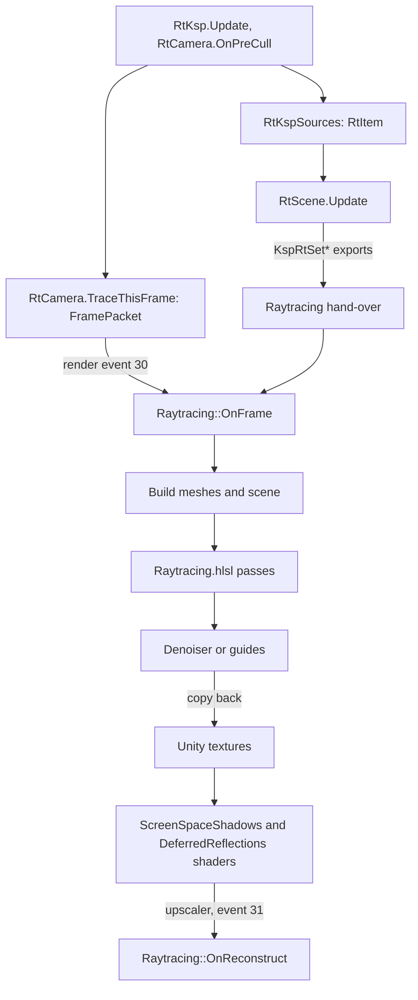

# Raytracing from scene to screen

**For:** anyone changing what the rays see, how they are traced, or how their light reaches
the picture.
**You need:** `src/Raytracing`, `src/Proxy/RtNative.cs` and `src/DxgiProxy/Raytracing` open.
**You get:** the route from a KSP mesh to a lit pixel, which file does each step, and
where it logs.

The raytracing traces the sun's shadows, the occlusion, the diffuse light and the reflections
for every pixel of the scene camera. The mod collects the scene and sends it to the proxy.
The proxy builds acceleration structures on its Direct3D 12 device, traces with compute
shaders, and copies the light back into Unity's textures. Two shaders in Unity's lighting
then read it. The shared textures and fences work as they do for the upscalers in
[the proxy's present path](flow-proxy-present.md).

## The route from mesh to pixel

1. `RtKsp.Apply` takes the mode the player chose. `RtKsp.Update` runs every frame from the
   add-on. When the mode is on, `RtKsp.Attach` puts an `RtCamera` on the scene camera. It
   first asks `RtNative.Ready` whether the proxy answers and `ShaderBundle.LoadShader`
   whether the bundle has `Hidden/ReDefinition/RtCapture`.
2. In `RtCamera.OnPreCull`, `RtScene.Update` asks every source for its items. The sources in
   `src/Raytracing/Ksp/RtKspSources.cs` are `RtVesselSource`, `RtTerrainSource` and
   `RtScenerySource`. Each `Collect` adds `RtItem` values through `RtFilter.Add`, which keeps
   what `RtFilter.Opaque` and `RtFilter.Drawn` accept. `RtParallaxScatter.CollectGpu` adds
   instances only the GPU knows.
3. `RtScene.Update` hands each new mesh over once with `RtScene.Upload`, which calls
   `RtNative.KspRtSetMesh`. `RtScene.SendMaterial` does the same for a material, and
   `RtScene.ReadTextures` sends its small texture. The instances go every frame, relative
   to the camera, through `RtNative.KspRtSetInstances` and `KspRtSetGpuGroups`.
4. The exports land in `Raytracing::SetMesh`, `SetMaterial` and `SetInstances` in
   `src/DxgiProxy/Raytracing/Raytracing.cpp`. They copy the data into a hand-over under a
   lock. Nothing touches Direct3D 12 on the main thread.
5. `RtCamera.TraceThisFrame` records the camera's command buffer. It copies the G-buffer into
   render textures, copies the depth with `ReDefinitionRtCapture.shader`, and fills an
   `RtNative.FramePacket` in `RtCamera.FillPacket`. `PacketRing.Issue` raises render event 30,
   `RtNative.FrameEvent`.
6. On Unity's render thread, `DispatchRenderEvent` calls `Raytracing::OnFrame`. It takes the
   hand-over with `TakeHandOverLocked`, shares Unity's textures in `TakeTexturesLocked`, and
   starts one slot's command list in `BeginListLocked`.
7. `Raytracing::BuildMeshesLocked` in `RaytracingScene.cpp` builds the acceleration structure
   of each new mesh. `RaytracingBuild.cpp` holds the pools it builds in.
   `Raytracing::BuildSceneLocked` then builds the scene's top-level structure from the frame's
   instances.
8. `Raytracing::RunPassesLocked` dispatches one compute shader per signal, in the order of
   `kRtPassOrder`. The shaders are in `src/DxgiProxy/Raytracing/Shaders/Raytracing.hlsl`.
   They trace with `RayQuery` and share `RtCommon.hlsli`.
9. `Raytracing::RunDenoisersLocked` cleans the signals. It uses AMD's Ray Regeneration on a
   Radeon RX 9000 or newer (`RunRegenerationLocked`), else the proxy's own denoiser
   (`RunDenoiserLocked`, `Denoise.hlsl`). When Ray Reconstruction takes the frame, the packet
   carries `RtNative.FlagGuides` instead of `FlagDenoise`. `WriteFrameGuidesLocked` then
   writes the guides.
10. `Raytracing::FinishFrameLocked` submits the list, makes Direct3D 11 wait for its fence, and
    copies each result into the texture the packet named. The render event returns.
11. Unity lights the frame. `RtLighting.Keep` has put `ReDefinitionScreenSpaceShadows.shader`
    in place of Unity's shadow collection. It has done the same with
    `ReDefinitionDeferredReflections.shader` over Deferred's reflections pass.
    `RtCamera.TraceThisFrame` sets the results as globals such as `_ReDefinitionRtSun`.
12. When Ray Reconstruction is on, the upscaler takes the frame.
    `UpscalerRig.SubmitReconstruction` in `src/Upscaler/Rig/UpscalerRig.Reconstruction.cs`
    raises event 31. `Raytracing::OnReconstruct` chooses a route in `ChooseRoute`. It calls
    `Streamline::EvaluateRayReconstruction` or NGX's `DlssRayReconstruction::Evaluate`.
    Either one denoises and upscales in one step.

## What the contract holds

The mod, the proxy and the shaders must agree on layouts and numbers. `RtContract.h` in
`src/DxgiProxy/Raytracing/Shaders` holds them. It has the event ids, the magic numbers, the
flags and the signals. It also has the input and output slots and the register of every
field of `cbuffer Frame`.
`RtContractTests` in `tests/ReDefinition.Tests/RtContractTests.cs` holds `RtNative.cs` to it,
and the `static_assert` lines in `Raytracing.h` hold the proxy's structures to it.

At run time, `RtNative.Ready` compares `KspRtStructSizes` with the managed structures. Every
packet also carries a size and a magic that the proxy checks.

## The harness

`tests/DxgiProxy/RaytracingHarness.cpp` runs the proxy's raytracing without KSP. It loads
`dxgi.dll` as Unity does, rasterises a G-buffer in Unity's layout and calls the same exports
the mod calls. It sends frames through the render event and compares the result with the
CPU. It writes an image of each check next to the executable and returns 0 when all pass.
Run it after every change to a pass, the contract or the scene.

## Where to change it

- What the rays see: add an `IRtSource` in `src/Raytracing/Ksp/RtKspSources.cs`, and
  register it with `RtScene.AddSource` in `RtKsp.Attach`.
- A field in the frame packet: change `RtNative.FramePacket`, `RtFramePacket` in `Raytracing.h`
  and `RtContract.h` together, then run the tests and the harness.
- A pass or its maths: `Raytracing.hlsl` and `RtCommon.hlsli`. A new compute shader also
  needs a CMake entry. [How shaders reach the game](flow-shaders.md) lists the steps.
- How the light enters the picture: `ReDefinitionScreenSpaceShadows.shader` and
  `ReDefinitionDeferredReflections.shader` in `unity/Assets/ReDefinition/Shaders`.

## What can go wrong

- No ray queries: the proxy log says `Raytracing: not available` and the reason, which is
  the GPU's or the driver's raytracing tier. The mod's `KSP.log` repeats it as
  `Raytracing does not run:`.
- The proxy was built without `dxc`: `this build of the proxy has no raytracing shaders`.
- Mod and proxy are from different builds: `the proxy's raytracing structures differ from
  ReDefinition's` in `KSP.log`, and `a frame rejected: the mod and the proxy disagree on its
  layout` in the proxy log.
- The shader bundle is old: `raytracing's shaders are missing from the shader bundle`, or
  `was it rebuilt after that shader was added?`. Build the bundle again.
- A mesh is refused or left out: `mesh N rejected` in the proxy log, and `skipped (` with a
  reason in the mod's report line every thirty seconds.
- The service lets go of its device, for example when a swapchain is made again:
  `KspRtGeneration` changes, and `RtScene.Update` hands every mesh and material over
  again. Expect a short stall.
- The GPU removes the device: the status text starts with `device removed (`. KSP has to
  restart.
- Ray Reconstruction gives up: `DLSS Ray Reconstruction showed no frame; DLSS Super
  Resolution for 10 s` in `KSP.log`. It also stays off on an LDR camera.
