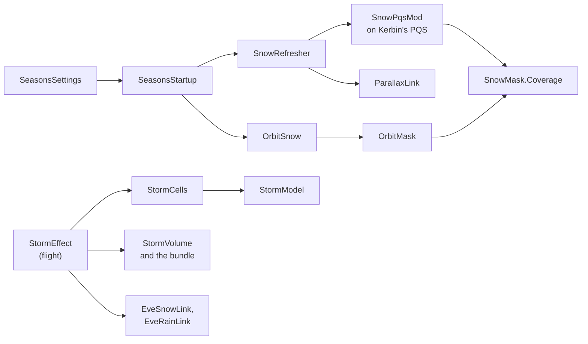

# The seasons

ReDefinition Seasons is a mod of its own, `ReDefinition.Seasons.dll`. It paints snow on
Kerbin by a season clock, shows the same snow in the orbit view, and runs snow storms over
the cold regions. Read this page to find where a stage lives and where to change it. The
player's view is [player/seasons.md](../player/seasons.md), and the area's own file list is
`src/Seasons/README.md`.

The seasons use `Core` in `ReDefinition.Common.dll` and nothing else of ReDefinition. They
name neither ReDefinition, Harmony nor ZTheme, and ReDefinition names nothing of them
(`tools/checks/check_no_reference.ps1` and `tests/ReDefinition.Tests/ArchitectureTests.cs`).
Parallax and EVE are optional. The seasons reach them by reflection only, each through one
class.

## The ground

1. `SeasonsStartup` is a `[KSPAddon(KSPAddon.Startup.Instantly, true)]`. It checks the
   Common version, reads `SeasonsSettings.Load`, adds `SnowRefresher` and `OrbitSnow` as
   components, and writes one line to `KSP.log` with the settings and which of Parallax and
   EVE it found.
2. `SeasonsSettings` keeps the settings in `GameData/ReDefinition/Seasons/PluginData/settings.cfg`.
   Without this file the defaults apply.
3. `SnowRefresher.Update` waits for Kerbin's PQS and then adds `SnowPqsMod` to it
   (`SnowRefresher.TryInstall`). The mod's sort order is `int.MaxValue - 10`, so it runs
   after the colour mods.
4. When a quad is built, `SnowPqsMod.OnVertexBuild` moves each vertex colour toward the snow
   colour by `SnowMask.Coverage` times the snow strength. `SnowMask.Coverage` is a pure
   function of latitude, height, season phase and noise. `SeasonClock` gives the phase from
   the universal time. `SnowQuads` keeps the colour a vertex had before, with its latitude,
   height and noise, so that a quad can be painted again.
5. `SnowRefresher` then follows the setting `groundRefreshMode`. In `Live` it repaints the
   built quads from the stored originals within a time budget per frame (`LivePass`,
   `Repaint`). In `Rebuild` it calls `PQS.RebuildSphere` where no vessel stands on the
   ground (`RebuildCheck`, `SafeToRebuild`). In `Off` only quads built later get the phase.
6. After a repaint, `ParallaxLink` tells Parallax. `ParallaxLink.TerrainChanged` calls
   `OnQuadNormalUpdate` on the quad's terrain data, so the terrain mesh reads the colours
   again. `ParallaxLink.Recolour` writes the new colours into the quad's scatter data and,
   when the mean snow of the quad moved enough, calls `Cleanup` and `Start` on each
   `ScatterData`.

`ParallaxLink` keeps the field and method handles it found. A symbol that is missing is
logged once, and that part is left out. A call that fails several times in a row switches
its path off (`FailureStreak`).

## The orbit view

`OrbitSnow` is a component that draws the same snow on Kerbin's scaled-space planet.

1. It reads the planet's colour map from the material at run time: `_ColorMap` with
   Parallax, otherwise `_MainTex`.
2. It copies that map into a render texture, draws the snow mask over a second copy, and
   sets the result as the material's map. The planet's own texture is never written to.
3. `OrbitMask.Fill` makes the mask by calling `SnowMask.Coverage` for every texel. It is a
   pure function and runs on a worker thread, as does the noise table
   (`OrbitSnow.StartNoise`). The heights come from the PQS once, in small slices per frame.
4. `OrbitMask.Due` decides when to compose again, from the real time passed and the phase
   moved.

## The storms

A storm is a cell that stands on the planet.

1. `StormModel.Draw` is the spawn rule. Time is cut into slots per hemisphere and per band
   of latitude. A hash of the seed and the slot decides whether a storm happens, when it
   starts and how it rises, peaks and decays. The chance is gated by `SnowMask` and by how
   wintry the hemisphere is, so there are no storms near the equator or in summer.
2. `StormCells.Collect` turns the draws into cells with a place, a radius, a life and a
   drift, all pure functions of the seed and the universal time. `StormCells.IntensityAt`
   is the strength at a point, and `StormCells.Nearest` keeps the cells to draw.
3. `StormEffect` is a `[KSPAddon(KSPAddon.Startup.Flight, false)]`. Each frame it collects
   the cells near the flight camera, takes the intensity at the camera, scales it with the
   vessel's altitude (`StormLook.HeightFactor`), and follows that target smoothly.
4. From the applied intensity, `StormLook` computes the numbers: visibility, fog density,
   veil alpha, sky grey, ambient factor, and the flakes' rate, size and wind. `StormEffect`
   sets the fog in `RenderSettings`. `StormVeil` draws the veil grid in front of the
   camera. `StormFlakes` runs the three particle layers. `StormAmbient` and
   `AmbientTracker` scale the ambient light in `Camera.onPreCull` and put back what they
   changed.
5. `StormVolume` draws each cell in the world. It reads the shader bundle
   `GameData/ReDefinition/Seasons/Shaders/seasons.shaders` through
   `StormShaders.LoadVolumeShader`. The bundle holds one shader,
   `ReDefinition/SeasonsStormVolume`, whose source is
   `unity/Assets/ReDefinitionSeasons/Shaders/ReDefinitionSeasonsStormVolume.shader`.
   It marches the view ray through a bounding cylinder of the cell, with the 3D noise from
   `StormNoise`. The cylinder and the numbers are in `StormVolumeMath`. If the bundle is
   missing or does not load, `StormVolume` draws shells, a dome and puffs from the game's
   particle shaders instead (`StormShaders.BlendedNames`). The setting `stormVolumeMode`
   chooses.
6. The Seasons are made to run with EVE's volumetric clouds (the StockVolumetricClouds pack).
   With `stormClouds = Existing` (the default) the cell is painted into the layers EVE already
   has on Kerbin, `EveLayerStorm`, and steps 7 and 8 describe the mod's own layer that `Own`
   uses. Which layers: the installed `clouds.cfg` has `Kerbin-base-layer` (1750 to 3450 m, types
   Stratus, Cumulus, Congestus 0 to 3, a 2D layer, always on), `Kerbin-cumulonimbus-layer`
   (convective, 1750 to 11450 m) and `Kerbin-Weather-1` and `Kerbin-weather-2` (-20 to 2150 m,
   types Fog, Rain, Thunder, Polar-fog, Polar-snow, faded in and out by `timeSettings`, tinted
   blue, with the rain particle field). A layer with a snow type is a snow layer: the cell's
   cloud-type value there is that type, which is the last one (1.0: EVE reads the type of a
   texel as the red value, index = value x (count - 1), and `SampleCoverage` interpolates the
   two types around a fractional index). A layer with a Stratus type that starts below 3000 m
   is the body layer: its type is Stratus (0.0). The cumulonimbus layer and the stock snow
   particle layers are left alone. The layers' maps are BC4 textures (8192 x 4096 base layer,
   2048 x 1024 weather layers); `EveLayerStorm` reads them with `GetPixels32`, makes R8 copies
   and composites the cell into them with a screen blend (coverage) and a smoothstep from the
   layer's own type to the target type (the type map). The cell is the lobes of
   `EveStormMath.Lobes`: 5 to 7 overlapping discs, spread along the wind over 1.3 to 2 times the
   radius, breathing with the time, growing from 40 % of their size with the storm's strength.
   The direction of a cell in a layer's frame is the body-frame direction (`GetRelSurfaceNVector`)
   times the matrix of `CloudsPQS.GetMainRotationAtUT`, which is current at any altitude; while
   the volume is current its own matrix is used and the log gives the angle between the two
   (`frame check`). The maps are written once a second (the base layer's upload is 2 x 33 MB),
   restored from the originals in the rectangles the cells touched, and put back after 30 s
   without a cell near, when the setting goes off, when the scene unloads or when a step fails.
   In the 2D layer `_MainTex` of the material becomes a render texture (4096 x 2048 at most) that
   holds the original picture with the swirl drawn over it (`EveStormMath.Swirl`, fans of
   triangles with `Sprites/Default`, premultiplied, so that the alpha adds up as clouds do).
   The veil of the mod's volume starts at the base of the body layer (`EveLayerStorm.BaseAslM`,
   1750 m above sea level), and a cell over ground higher than the layer's top is logged once.
   `GameData/ReDefinition/Seasons/Clouds/SeasonsStormLayer.cfg` defines two
   OBJECTs on Kerbin, which EVE reads from `GameDatabase`, and the particle field config for
   the snow. `StormEffect` collects the cells twice a second (within 150 km of the camera,
   from 150 km up and in the map view the cells of the whole planet,
   `EveCellLayer.RangeFor`) and passes them to `EveCellLayer.Update` every frame.
   `EveCellLayer` finds the layers in `CloudsManager.GetObjectList()`.
7. `ReDefinition-Seasons-Storm` is the cloud. Its volume gets a readable 4096 x 2048 R8
   texture in `TextureWrapper.textureValue` and in the two materials as `CloudCoverage`, and
   the cells are painted into it (`EveCoverageMath`, EVE's equirectangular convention) while the
   volume is current: below 250 km and not in the map view, the only times EVE updates the
   matrix the directions come from. The layer is switched off through its `CloudsPQS` while no
   cell is near. After the first paint the mod compares EVE's own `SampleCoverage` at the
   centre of the strongest cell with the painted value and logs
   `storm layer calibration: ...`; a longitude shift it finds is applied to the painting.
   While the layer is bound (`EveCellLayer.Supplying`) `StormVolume` sets `_CloudWeight` to 0,
   so that the shader draws the snow veil only, and starts the veil at the layer's cloud base.
8. The same OBJECT holds a `layer2D` node. EVE's 2D layer is the scaled-space form of a cloud
   layer: it fades in from 200 km up (`scaledFadeStartAltitude`) and shows fully in the map view,
   on a sphere with the radius of the body plus the OBJECT's `altitude` (2700 m), using shader
   `EVE/Cloud`. A 2D layer in an OBJECT of its own would be dropped by EVE once a raymarched
   layer of the body exists. The volume takes its own sphere from the cloud types'
   altitudes, so the OBJECT's altitude does not move the volume (the log line `cloud from 500
   to 2300 m above sea level` stays). `EveCellLayer` puts a 2048 x 1024 RGBA picture
   into the `_MainTex` wrapper of `CloudsObject.Layer2D.CloudsMat` and onto
   `Layer2D.CloudRenderingMaterial`, sets that material's queue to 3000 (EVE's is 2999, in an
   order nobody sets) and paints each cell as a swirl (`EveSwirlMath`): two arms, a closed core,
   white-grey with the alpha of the cloud, a disc on the sphere (wider in texels toward the
   poles), at least 2.5 texels (4.6 km) in radius. The directions are the body's own
   (`GetRelSurfaceNVector`), because EVE does not update the volume's matrix above its fade;
   `storm layer: frame check` logs the angle to the volume's direction when a cell is painted
   in the atmosphere. The picture is repainted every 2 s.
9. `ReDefinition-Seasons-Snow` is the snow: EVE's particle field `ReDefinition-Seasons-snow`
   (defined in the same config: the stock `snow-Kerbin` with more, larger, faster flakes) and the
   stock snow sound, from the ground to 2300 m. A volume gives no coverage below its lowest
   altitude (`SampleCoverage` returns 0 for a height fraction below 0), and the cloud starts at
   500 m, so the field has a layer of its own, like the stock Snow-Particles layers
   (`fxOnlyLayer`). `EveCellLayer` binds it to the same texture. EVE draws the field where the
   coverage at the camera is above 0.05 and scales it up to 0.5. In a cell the raised stock
   fields and the mod's own flakes (`StormFlakes`) are off, unless the setting
   `stormOwnFlakes` asks for the flakes too.
10. With EVE installed, `EveSnowLink` raises the coverage of EVE's snow particle fields and
   the volume of its snow sound to the storm's intensity where no cell drives the field.
   `EveRainLink` takes EVE's rain away where the ground is snow or ice, and `EveSnowLink` gets
   the rain's coverage instead. Both reflect into EVE's private fields and put the first
   values back when the storm or the region ends.
11. Without EVE's volumetric layers, without the layers or with the setting `stormEveClouds`
   off, `_CloudWeight` is 1, the shader draws its own snow cloud, the orbit view shows no
   cell and the own flakes fall. That path gets no further work.

The bundle is built by `tools/build_seasons_bundle.ps1`, which runs
`unity/Assets/ReDefinitionSeasons/Editor/SeasonsBundleBuilder.cs` in Unity 2019.4.18f1. The
release package takes `seasons.shaders` from there.

## Where to change it

| To change | Look in |
|---|---|
| The year length, the snow line, the strength | `SeasonClock`, `SnowMask`, `SeasonsSettings` |
| The snow colour and the blend | `SnowPaint` |
| How often the ground is painted again | `SnowRefresher` |
| What is told to Parallax | `ParallaxLink` |
| The map in the orbit view | `OrbitMask`, `OrbitSnow` |
| How often a storm starts, how long it lasts | `StormModel`, `StormCells` |
| How a storm looks in numbers | `StormLook` |
| The fog, the veil, the flakes, the ambient light | `StormEffect`, `StormVeil`, `StormFlakes`, `StormAmbient` |
| The cell in the world | `StormVolume`, `StormVolumeMath`, the shader file above |
| EVE's snow and rain | `EveSnowLink`, `EveRainLink`, `ReflectLink` |
| The cell inside EVE's existing layers | `EveLayerStorm`, `EveStormMath` |
| The cells' own cloud layer, swirl and the snow layer | `EveCellLayer`, `EveCoverageMath`, `EveSwirlMath`, `SeasonsStormLayer.cfg` |
| A new setting | `SeasonsSettings`, then [howto-add-a-setting.md](howto-add-a-setting.md) for the pattern |

## Tests

The tests are in `tests/ReDefinition.Tests`:

| Test file | What it holds |
|---|---|
| `SeasonClockTests.cs`, `SnowMaskTests.cs` | The clock and the snow function |
| `SnowGroundTests.cs`, `ParallaxScatterReaderTests.cs` | The repaint and the scatter data it reads |
| `OrbitSnowTests.cs` | The mask, the texture convention and when to compose |
| `StormTests.cs`, `StormCellsTests.cs` | The spawn rule and the cells |
| `StormVolumeTests.cs`, `StormSkyAndSnowfallTests.cs`, `StormBlizzardTests.cs` | The volume's numbers, the noise, the sky, the flakes and the veil at the horizon |
| `EveCoverageTests.cs` | EVE's equirectangular map and its round trip, the painting of cells, the date line, the setting and the layers' config |
| `EveStormMathTests.cs` | The lobed cell (determinism, wind stretch, bounds), the composite and the restore, the date line, the cloud-type channel, the spiral swirl and its minimum size, the fan vertices, `stormClouds` |
| `EveSwirlTests.cs` | The 2D swirl: the arms, the widths on the picture, the smallest size, the range, `stormOwnFlakes` |
| `SeasonsStandaloneTests.cs` | The mod's own files and settings |

`ArchitectureTests.cs` holds the rule that the seasons use nothing of ReDefinition beyond
`Core`. The tests run the pure functions. The checks in the game are run by hand with
`.local/work/seasons-test/check_seasons.py` (modes `orbit`, `cell`, `storm`). Seen so far: the
cell layers bind, the calibration agrees (and the frame check of the 2D picture is 0.00
degrees), a red marker (`EveSwirlMath.Probe`) shows the 2D layer in the right place with the
right size from 1000 km, a cell inside shows EVE's snow field and a cell 8 km away is EVE's
cloud. Open: the swirl from a lower orbit and in the map view, the look of the cell at 25 km, the
sound, and the order of the 2D layer against what is drawn after it: part of the red marker
was covered by thick white cloud although the layer's queue is 3000, so something draws later
(not identified) [open].

## What can go wrong

* Parallax is not installed or changed a member. The start line says `Parallax not found`,
  or `ParallaxLink` logs which symbol is missing, and the ground is painted without the
  refresh.
* The bundle is missing, or comes from another Unity version. `StormShaders` logs the
  reason, and `StormVolume` falls back to the plain shapes in the `Auto` mode.
* EVE is not installed or has changed a field. `EveSnowLink.Summary` and
  `EveRainLink.Summary` in the start line say `not found` or name what is missing, and the
  storm keeps its own flakes. `EveCellLayer` logs `storm layer: ...` with the member that is
  missing (`Layer2D`, `CloudsMat`, `_MainTex`, `particleField`); the volume still works and
  the cell has no picture in the orbit view.
* The 2D layer's render queue is reset by EVE when the layer goes between scaled and local
  space (2999 in scaled space, a lower one in local space was logged). `EveCellLayer` sets 3000
  on every paint.
* Another mod writes the ambient light. `AmbientTracker` takes its value as the new
  baseline, and the log counts how often that happened.
