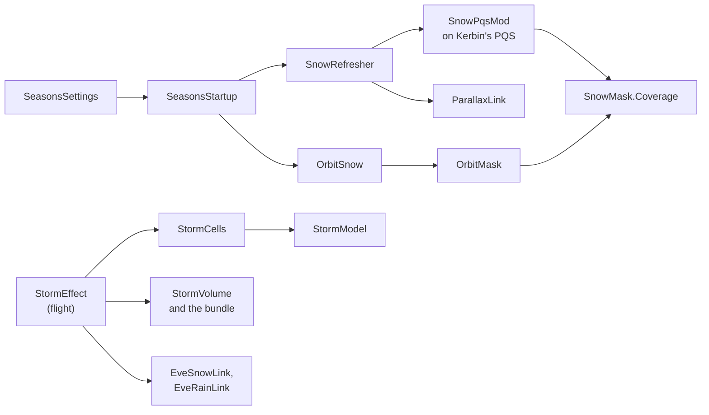

# The seasons

ReDefinition Seasons is a mod of its own, `ReDefinition.Seasons.dll`. It paints snow on
Kerbin by a season clock, shows the same snow in the orbit view, and runs snow storms over
the cold regions. Read this page to find where a stage lives and where to change it. The
player's view is [player/seasons.md](../player/seasons.md), and the area's own file list is
`src/Seasons/README.md`.

The seasons use `Core` in `ReDefinition.Common.dll` and nothing else of ReDefinition. They
name neither ReDefinition, Harmony nor ZTheme, and ReDefinition names nothing of them
(`tools/checks/check_no_reference.ps1` and `tests/ReDefinition.Tests/ArchitectureTests.cs`).
Parallax and EVE are optional. The seasons reach them by reflection only, each through one
class.

## The ground

1. `SeasonsStartup` is a `[KSPAddon(KSPAddon.Startup.Instantly, true)]`. It checks the
   Common version, reads `SeasonsSettings.Load`, adds `SnowRefresher` and `OrbitSnow` as
   components, and writes one line to `KSP.log` with the settings and which of Parallax and
   EVE it found.
2. `SeasonsSettings` keeps the settings in `GameData/ReDefinition/Seasons/PluginData/settings.cfg`.
   Without this file the defaults apply.
3. `SnowRefresher.Update` waits for Kerbin's PQS and then adds `SnowPqsMod` to it
   (`SnowRefresher.TryInstall`). The mod's sort order is `int.MaxValue - 10`, so it runs
   after the colour mods.
4. When a quad is built, `SnowPqsMod.OnVertexBuild` moves each vertex colour toward the snow
   colour by `SnowMask.Coverage` times the snow strength. `SnowMask.Coverage` is a pure
   function of latitude, height, season phase and noise. `SeasonClock` gives the phase from
   the universal time. `SnowQuads` keeps the colour a vertex had before, with its latitude,
   height and noise, so that a quad can be painted again.
5. `SnowRefresher` then follows the setting `groundRefreshMode`. In `Live` it repaints the
   built quads from the stored originals within a time budget per frame (`LivePass`,
   `Repaint`). In `Rebuild` it calls `PQS.RebuildSphere` where no vessel stands on the
   ground (`RebuildCheck`, `SafeToRebuild`). In `Off` only quads built later get the phase.
6. After a repaint, `ParallaxLink` tells Parallax. `ParallaxLink.TerrainChanged` calls
   `OnQuadNormalUpdate` on the quad's terrain data, so the terrain mesh reads the colours
   again. `ParallaxLink.Recolour` writes the new colours into the quad's scatter data and,
   when the mean snow of the quad moved enough, calls `Cleanup` and `Start` on each
   `ScatterData`.

`ParallaxLink` keeps the field and method handles it found. A symbol that is missing is
logged once, and that part is left out. A call that fails several times in a row switches
its path off (`FailureStreak`).

## The orbit view

`OrbitSnow` is a component that draws the same snow on Kerbin's scaled-space planet.

1. It reads the planet's colour map from the material at run time: `_ColorMap` with
   Parallax, otherwise `_MainTex`.
2. It copies that map into a render texture, draws the snow mask over a second copy, and
   sets the result as the material's map. The planet's own texture is never written to.
3. `OrbitMask.Fill` makes the mask by calling `SnowMask.Coverage` for every texel. It is a
   pure function and runs on a worker thread, as does the noise table
   (`OrbitSnow.StartNoise`). The heights come from the PQS once, in small slices per frame.
4. `OrbitMask.Due` decides when to compose again, from the real time passed and the phase
   moved.

## The storms

A storm is a cell that stands on the planet.

1. `StormModel.Draw` is the spawn rule. Time is cut into slots per hemisphere and per band
   of latitude. A hash of the seed and the slot decides whether a storm happens, when it
   starts and how it rises, peaks and decays. The chance is gated by `SnowMask` and by how
   wintry the hemisphere is, so there are no storms near the equator or in summer.
2. `StormCells.Collect` turns the draws into cells with a place, a radius, a life and a
   drift, all pure functions of the seed and the universal time. `StormCells.IntensityAt`
   is the strength at a point, and `StormCells.Nearest` keeps the cells to draw.
3. `StormEffect` is a `[KSPAddon(KSPAddon.Startup.Flight, false)]`. Each frame it collects
   the cells near the flight camera, takes the intensity at the camera, scales it with the
   vessel's altitude (`StormLook.HeightFactor`), and follows that target smoothly.
4. From the applied intensity, `StormLook` computes the numbers: visibility, fog density,
   veil alpha, sky grey, ambient factor, and the flakes' rate, size and wind. `StormEffect`
   sets the fog in `RenderSettings`. `StormVeil` draws the veil grid in front of the
   camera. `StormFlakes` runs the three particle layers. `StormAmbient` and
   `AmbientTracker` scale the ambient light in `Camera.onPreCull` and put back what they
   changed.
5. `StormVolume` draws each cell in the world. It reads the shader bundle
   `GameData/ReDefinition/Seasons/Shaders/seasons.shaders` through
   `StormShaders.LoadVolumeShader`. The bundle holds one shader,
   `ReDefinition/SeasonsStormVolume`, whose source is
   `unity/Assets/ReDefinitionSeasons/Shaders/ReDefinitionSeasonsStormVolume.shader`.
   It marches the view ray through a bounding cylinder of the cell, with the 3D noise from
   `StormNoise`. The cylinder and the numbers are in `StormVolumeMath`. If the bundle is
   missing or does not load, `StormVolume` draws shells, a dome and puffs from the game's
   particle shaders instead (`StormShaders.BlendedNames`). The setting `stormVolumeMode`
   chooses.
6. With EVE's volumetric clouds installed, the snow cloud of the cells is a layer of EVE's.
   `GameData/ReDefinition/Seasons/Clouds/SeasonsStormLayer.cfg` defines the layer
   `ReDefinition-Seasons-Storm`, which EVE reads from `GameDatabase`. `StormEffect` collects
   the cells within 150 km twice a second and passes them to `EveCellLayer.Update` every
   frame. `EveCellLayer` finds the layer in `CloudsManager.GetObjectList()`, puts a readable
   4096 x 2048 R8 texture into `TextureWrapper.textureValue` and into the two materials as
   `CloudCoverage`, and paints the cells into it (`EveCoverageMath`, EVE's equirectangular
   convention). The texture is empty and the layer is switched off through its `CloudsPQS`
   while no cell is near. After the first paint it compares EVE's own `SampleCoverage` at the
   centre of the strongest cell with the painted value and logs
   `storm layer calibration: ...`; a longitude shift it finds is applied to the painting. While
   the layer is bound (`EveCellLayer.Supplying`) `StormVolume` sets `_CloudWeight` to 0, so that
   the shader draws the snow veil only, and starts the veil at the layer's cloud base. Without
   EVE's volumetric layers, without the layer or with the setting `stormEveClouds` off,
   `_CloudWeight` is 1 and the shader draws its own snow cloud.
7. With EVE installed, `EveSnowLink` raises the coverage of EVE's snow particle field and
   the volume of its snow sound to the storm's intensity. `EveRainLink` takes EVE's rain
   away where the ground is snow or ice, and `EveSnowLink` gets the rain's coverage
   instead. Both reflect into EVE's private fields and put the first values back when the
   storm or the region ends.

The bundle is built by `tools/build_seasons_bundle.ps1`, which runs
`unity/Assets/ReDefinitionSeasons/Editor/SeasonsBundleBuilder.cs` in Unity 2019.4.18f1. The
release package takes `seasons.shaders` from there.

## Where to change it

| To change | Look in |
|---|---|
| The year length, the snow line, the strength | `SeasonClock`, `SnowMask`, `SeasonsSettings` |
| The snow colour and the blend | `SnowPaint` |
| How often the ground is painted again | `SnowRefresher` |
| What is told to Parallax | `ParallaxLink` |
| The map in the orbit view | `OrbitMask`, `OrbitSnow` |
| How often a storm starts, how long it lasts | `StormModel`, `StormCells` |
| How a storm looks in numbers | `StormLook` |
| The fog, the veil, the flakes, the ambient light | `StormEffect`, `StormVeil`, `StormFlakes`, `StormAmbient` |
| The cell in the world | `StormVolume`, `StormVolumeMath`, the shader file above |
| EVE's snow and rain | `EveSnowLink`, `EveRainLink`, `ReflectLink` |
| The cells' cloud as an EVE layer | `EveCellLayer`, `EveCoverageMath`, `SeasonsStormLayer.cfg` |
| A new setting | `SeasonsSettings`, then [howto-add-a-setting.md](howto-add-a-setting.md) for the pattern |

## Tests

The tests are in `tests/ReDefinition.Tests`:

| Test file | What it holds |
|---|---|
| `SeasonClockTests.cs`, `SnowMaskTests.cs` | The clock and the snow function |
| `SnowGroundTests.cs`, `ParallaxScatterReaderTests.cs` | The repaint and the scatter data it reads |
| `OrbitSnowTests.cs` | The mask, the texture convention and when to compose |
| `StormTests.cs`, `StormCellsTests.cs` | The spawn rule and the cells |
| `StormVolumeTests.cs`, `StormSkyAndSnowfallTests.cs`, `StormBlizzardTests.cs` | The volume's numbers, the noise, the sky, the flakes and the veil at the horizon |
| `EveCoverageTests.cs` | EVE's equirectangular map and its round trip, the painting of cells, the date line, the setting and the layer's config |
| `SeasonsStandaloneTests.cs` | The mod's own files and settings |

`ArchitectureTests.cs` holds the rule that the seasons use nothing of ReDefinition beyond
`Core`. The tests run the pure functions. No test runs the storm or the orbit view in the
game, and the look of the storm has not been seen in the game [open].

## What can go wrong

* Parallax is not installed or changed a member. The start line says `Parallax not found`,
  or `ParallaxLink` logs which symbol is missing, and the ground is painted without the
  refresh.
* The bundle is missing, or comes from another Unity version. `StormShaders` logs the
  reason, and `StormVolume` falls back to the plain shapes in the `Auto` mode.
* EVE is not installed or has changed a field. `EveSnowLink.Summary` and
  `EveRainLink.Summary` in the start line say `not found` or name what is missing, and the
  storm keeps its own flakes.
* Another mod writes the ambient light. `AmbientTracker` takes its value as the new
  baseline, and the log counts how often that happened.
