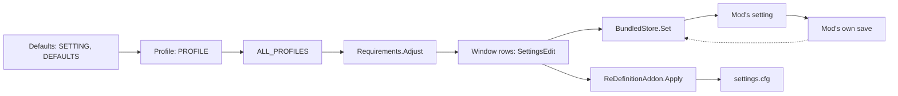

# A setting's path

**For:** a developer who adds a setting, or finds out why a value is not the one chosen.
**You need:** the repository, and a registration to follow, such as `Mods/Firefly.cfg`.
**You get:** the path of a value from a config file to a mod's save and back, for both kinds.

A setting is one value with a control and a default. ReDefinition keeps two kinds, and their
paths meet only in the settings window and the profile chooser. A bundled mod's setting lives
in that mod, which a registration names. ReDefinition's own setting lives in `settings.cfg` and
takes effect through the add-on's setters. Read the section that matches your setting.

## Another mod's setting

1. A registration is a `MOD_SETTINGS` node in `GameData/ReDefinition/Mods/*.cfg`, one per mod.
   `Firefly.cfg` names the mod's `detect` type, its `save` method, a `SETTING` per value with a
   `member` path and a `default`, and `PROFILE` blocks. A mod or a pack can ship its own.
2. `ModRegistry.LoadAll` in `src/Settings/ModRegistry.cs` reads every node from the
   `GameDatabase` once `ModRegistry.Ready` holds. `ModRegistration.FromConfigNode` parses a
   node and collects the problems. A registration from outside `ReDefinition/` takes
   precedence over ReDefinition's own.
3. `ModRegistry.Build` makes a `RegisteredMod` of each (`src/Settings/RegisteredMod.cs`). Its
   constructor looks up the `detect` type, resolves `save` and `ready` as `MemberPath`, and
   builds a `BundledSetting` per `SETTING` in `RegisteredMod.AddFrom`.
4. A member that this build of the mod lacks drops its setting, with the reason in
   `RegisteredMod.DroppedMembers`. A mod with at least one setting left has `IsInstalled`.
5. `BundledSettings` in `src/Settings/BundledSettings.cs` holds the mods and one
   `BundledStore`. The store reads `bundled.cfg` through `BundledFile.Read` into a
   `BundledLedger` (the kept values and the values from before ReDefinition) and a
   `BundledState` (switch and profile).
6. The value layers come together in `ProfileApplier.Values` in
   `src/Settings/ProfileApplier.cs`, each over the one before:
   1. the defaults, from `ModDefaults.Values`: a `SETTING`'s `default`, then the `DEFAULTS`
      blocks that fit the installed build, then `ModBehaviour.Default`;
   2. the chosen profile, from `ModProfiles.Select`: the `PROFILE` blocks of its name, quality
      settings only;
   3. `ALL_PROFILES`, from `ModProfiles.SelectAll`: every kind of setting, for every profile;
   4. the requirements, from `Requirements.Adjust`: what an installed mod needs of the value.
7. The profile itself is a `GRAPHICS_PROFILE` node. `ProfileLibrary.LoadAll` reads them and
   `GraphicsProfile.FromConfigNode` parses one. It names a tier, and the mods' values stay in
   the registrations.
8. `SettingsWindow.Open` calls `SettingsWindow.ReadBundled`, which gives `SettingsEdit.Open`
   the value of each setting from `BundledSettings.Current`. The rows are copies. Choosing a
   profile fills them (`SettingsEdit.ChooseProfile`), and nothing reaches a mod before
   *Accept*.
9. *Accept* runs `SettingsWindow.Apply` in `src/Window/SettingsWindow/SettingsWindow.Apply.cs`.
   Its `ApplyBundled` step walks `SettingsEdit.Steps` and calls `BundledSettings.Set`,
   `Release` or `ResetTo` for each changed row.
10. `BundledStore.Set` adjusts the value through `Requirements`, keeps it in the ledger and
    calls `BundledStore.WriteToMod`. That first writes the mod's old value as the value from
    before ReDefinition into `bundled.cfg`, then calls `BundledSetting.Write`.
11. `BundledSettings.SaveNow` at the end of `Apply` calls `BundledStore.SaveMods`, which calls
    `RegisteredMod.Save`. That runs the behaviour's `Save` and then the `save` method, so the
    mod writes its own file. For a mod that saves in its own files, the value leaves the ledger
    once that save has worked.
12. The value comes back at scene events. `BundledStore.ReapplyStored` writes a kept value into
    a mod that holds another. `TufxBehaviour` and `DistantObjectBehaviour` hook the mod's own
    window and call `BundledSettings.TakeFromMod`. `Requirements.Enforce` corrects a forbidden
    value.
13. `SettingsWindow.SyncFromMods` runs four times a second (`ModWindowsAddon.Update`) and takes
    a change made in a mod's own window into the rows (`SettingsEdit.Sync`).

How a value lasts is the registration's `saving`: `InModFiles` (the mod saves it), `PerSave`
(the store sets it into every save as it loads) or `AtEveryStart` (the store sets it at every
start).

## ReDefinition's own setting

1. `OwnSettings` in `src/Modules/OwnSettings.cs` holds each value as a field with its default.
   `OwnSettings.Fields` lists the key in `settings.cfg`, how to parse and format it, and
   whether the add-on reads it live. The file is
   `GameData/ReDefinition/PluginData/settings.cfg`.
2. `OurModules` in `src/Modules/OurModules.cs` groups them into `GraphicsModule`s (`upscaler`,
   `frameGeneration`, `latency`, `raytracing`, `flightUi` and more). A `ModuleSetting` has a
   `Read` and a `Write` over `OwnSettings`, its `Kind`, tab (`Row`), `Order` and `TakesEffect`.
3. The window and KSP's settings dialog draw their rows from `OurModules.Rows`.
   `KspSettingsSection.Edit` holds the pair of copies, `Before` and `After`, that both edit.
4. The profiles come from `GameData/ReDefinition/Profiles/ReDefinition-Profiles.cfg`: five
   `GRAPHICS_PROFILE` nodes, `low` to `max`, each with a `MODULE` node per module.
5. `ModuleProfiles.Values` in `src/Modules/ModuleProfiles.cs` reads a `MODULE` node into
   `ModuleSetting` values. A value can differ by card (`ProfileValue.Resolve`).
   `ModuleProfiles.CanSet` refuses taste, hotkeys and interface settings.
   `ModuleProfiles.Apply` writes into `After`.
6. `SettingsWindow.ApplyOwn` calls `ReDefinitionAddon.Apply(before, after)` in
   `src/Modules/ReDefinitionAddon.Settings.cs`. It resolves *Auto* (`AutoSettings.Resolve`) and
   calls `ReDefinitionAddon.ApplyChanges`.
7. `ApplyChanges` compares the two copies field by field and calls the setter of each
   difference (`SetQuality`, `SetBackend`, `SetFrameGeneration` and the rest in
   `src/Modules/ReDefinitionAddon.Setters.cs`). It switches off first and on last.
8. A setter changes the running rig live, or calls `ReDefinitionAddon.Reattach`. However many
   settings ask, `RebuildRig` builds one new rig before `Apply` returns. `ChangeLiveSettings`
   copies the live fields into the object that features read (see [features](flow-game-ui.md)).
9. `ReDefinitionAddon.SaveSettingsIfChanged` writes `settings.cfg` through `OwnSettings.Save`.
   `Apply` forces it. Otherwise it compares `OwnSettings.Snapshot` every two seconds, and
   `ReDefinitionAddon.OnDestroy` saves once more.
10. Nothing switches on without a profile. `SetEnabled` and `SetFrameGeneration` refuse and say
    so on screen, and `ReDefinitionAddon.EnforceProfile` switches both off every frame.
11. *Reset* uses `OwnSettingsReset.From`: defaults for every setting, except the ones that are
    the player's menu. The main-menu question uses `ModuleProfiles.ApplyNow` for both halves.

## Where to change it

- A new setting of either kind, step by step: [add a setting](howto-add-a-setting.md).
- A value a mod needs, or a default per build: the registration in
  `GameData/ReDefinition/Mods`.
- What a tier sets for ReDefinition's own features: `GameData/ReDefinition/Profiles`.
- When a value reaches a mod: `BundledStore.ReapplyStored` and `BundledSettingsAddon`.

## What can go wrong

- A registration with a mistake is skipped or trimmed, and `BundledSettings` logs "Mod
  registrations" with the problem. A dropped member shows as "not bundled here" in the log.
- A profile problem reaches the log once as "Graphics profiles" (`ProfileApplier.Report`).
- A mod that cannot save logs "could not save the settings set in ReDefinition's window". The
  store tries again at the next scene change.
- A mod that cannot take a value yet keeps it in the ledger. The log says "kept; it reaches the
  mod once the mod can take it".
- `bundled.cfg` that cannot be written logs "Bundled settings could not be saved", and no mod
  that saves gets a value whose old value is not on disk.
- `settings.cfg` that cannot be written logs "Settings not saved, retrying".
