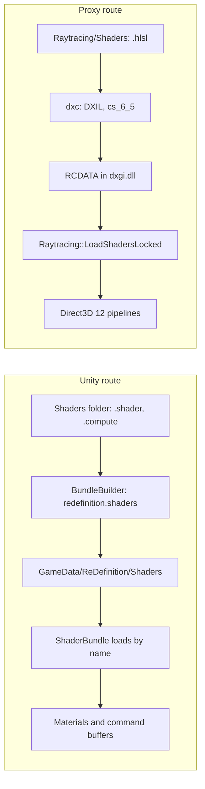

# How shaders reach the game

**For:** anyone who writes or changes a shader in ReDefinition.
**You need:** the repository, Unity 2019.4.18f1 for the Unity route, and CMake with the
Windows SDK's `dxc` for the proxy route.
**You get:** which of the two routes your shader takes, how it gets into the game, and the
steps to add one.

ReDefinition ships shaders by two routes that never meet. Unity's shaders run inside KSP's
Direct3D 11 renderer: the upscaler's compute passes, the masks and the lighting shaders. The
proxy's HLSL runs on its own Direct3D 12 device: the raytracing passes. A Unity player
cannot compile shaders at run time, and the proxy compiles its passes when you build it.

## The Unity route

1. The sources are in `unity/Assets/ReDefinition/Shaders`. Each `.shader` and `.compute` file
   at the top of that folder goes into the bundle. Files they include do not: the `.cginc`
   files and the `shaders` subfolder stay out of the list.
2. `BundleBuilder.Build` in `unity/Assets/ReDefinition/Editor/BundleBuilder.cs` makes one
   AssetBundle, `redefinition.shaders`. `BundleBuilder.EnsureGraphicsApis` first sets
   Direct3D 11 and Direct3D 12 for the build, because a bundle without Direct3D 12 kernels
   fails every `Dispatch` there. It writes the file to `GameData/ReDefinition/Shaders`.
3. `ShaderBundle` in `src/Upscaler/Rig/ShaderBundle.cs` loads the file from
   `ShaderBundle.BundlePath`. A bundle from another Unity version is rejected without a word.
4. Callers ask the bundle by name. `ShaderBundle.LoadShader` finds a shader by its `Shader`
   name, such as `Hidden/ReDefinition/Masks`. `ShaderBundle.LoadCompute` finds a compute
   shader by its file name. `ShaderBundle.MakeMaterial` makes a material and checks that
   the shader has enough passes.
5. The add-on loads the FSR set at start. `ShaderBundle.Load` returns an
   `Fsr3UpscalerShaders`. When it returns null, `ReDefinitionAddon` logs
   `Upscaler not operational:`.

### The FSR 3 shaders

The upscaler's compute passes are AMD's, through Nico de Poel's FSR3Unity. Unity 2019.4 has
neither `multi_compile` in compute shaders nor `SetComputeConstantBufferParam`.
`tools/port_fsr3_shaders.py` therefore makes the files in the Shaders folder from an FSR3Unity
checkout. It bakes the keywords in. It writes a `_ldr` copy of every pass and a `_sharpen`
copy of the accumulate pass. It turns each constant buffer into a `StructuredBuffer`.

`ShaderBundle.Load` picks the files by name and suffix: `_ldr` when the camera renders without
HDR, `_sharpen` when sharpening is on. The C# side is `src/Fsr3`. `Fsr3Upscaler.CreateContext`
takes the set, and each `Fsr3UpscalerPass` dispatches its shader and binds its constants as
a buffer (`Fsr3Constants.cs`). Change the FSR files through the script, never by hand.

### Add a Unity shader

1. Add `ReDefinitionName.shader` or `ReDefinitionName.compute` to the Shaders folder. Name a
   `.shader` `Hidden/ReDefinition/Name`. Open the project in Unity once, so that it writes
   the `.meta` file, and keep that file.
2. Do not use `multi_compile` in a compute shader. Bake the keyword in, as the FSR files do.
3. Build the bundle. In the editor, choose *ReDefinition, Build AssetBundle*. Headless, run
   `Unity.exe -batchmode -quit -projectPath unity -executeMethod
   ReDefinition.EditorTools.BundleBuilder.BuildFromCommandLine`.
   [Building and testing](building-and-testing.md) has the full command.
4. Load it. Give the name a constant in `ShaderBundle`, as `MaskShaderName` does, and call
   `LoadShader`, `LoadCompute` or `MakeMaterial`. Show the returned `error` to the caller.
5. `ReDefinition.cginc` in `unity/Assets/ReDefinition/Include` is for other mods' shaders.
   It is not in the bundle, and `IncludeCheck.RunFromCommandLine` compiles it on its own.

## The proxy route

1. The passes are `.hlsl` files in `src/DxgiProxy/Raytracing/Shaders`. Each has one or more
   entry points, and they share `RtCommon.hlsli` and `RtContract.h`.
2. `src/DxgiProxy/CMakeLists.txt` lists every entry point in `REDEFINITION_RT_ENTRIES` as
   `File:Entry`. For each, it runs `dxc` with `-T cs_6_5 -HV 2021 -O3 -WX`, so a warning
   fails the build.
3. The DXIL goes into `dxgi.dll` as a resource of type `RCDATA` named `RT_<Entry>`. CMake
   writes the `RaytracingShaders.rc` that lists them.
4. `Raytracing::LoadShadersLocked` in `RaytracingDevice.cpp` reads every name in `kRtPasses`
   and `kRtDenoiseEntries` from the DLL. `Raytracing::BuildPipelinesLocked` makes one
   compute pipeline of each, all on the same root signature.
5. A frame looks the pipeline up and dispatches it. The signals' passes are in `pipelines`,
   run by `Raytracing::RunPassesLocked`. The others are in `denoisePipelines` by name, such
   as `RT_FrameGuides` in `Raytracing::WriteFrameGuidesLocked`.

Other proxy shaders are source strings that `D3DCompile` compiles at run time with `cs_5_0`.
They are the flip in `FrameGenerationInputs.cpp`, the UI plane in `FrameGenerationUi.cpp`
and the passes mods bring through `CompileComputeShader`. They need no build step. The
[shared foundation](../modders/shared-foundation.md) page covers the last kind.

### Add a proxy pass

1. Write the entry point in a `.hlsl` file with `[numthreads(8, 8, 1)]`, and include
   `RtCommon.hlsli`. A new binding or constant goes into `RtContract.h` first, so that the
   C++ and the HLSL agree.
2. Add `File:Entry` to `REDEFINITION_RT_ENTRIES` in `CMakeLists.txt`.
3. Add `L"RT_Entry"` to `kRtDenoiseEntries` in `RaytracingInternal.h`. A pass with a signal of
   its own goes into `kRtPasses` with a new `kRtSignal` bit instead, which the contract
   and `RtNative.cs` must also name.
4. Dispatch it where it belongs, with the tables the other passes use, and check it in
   `tests/DxgiProxy/RaytracingHarness.cpp`.
5. Build with `cmake --build build/DxgiProxy --config Release`, then run the harness.

## Where to change it

- The bundle's contents or settings: `unity/Assets/ReDefinition/Editor/BundleBuilder.cs`.
- How the mod finds a shader: `src/Upscaler/Rig/ShaderBundle.cs`.
- The proxy's shader list and flags: `src/DxgiProxy/CMakeLists.txt` and
  `src/DxgiProxy/Raytracing/RaytracingInternal.h`.

## What can go wrong

- The bundle is missing: `AssetBundle not found:` in `KSP.log`. Build it.
- The bundle comes from another Unity version: `AssetBundle could not be loaded:`.
- The bundle is older than a shader: `the shader bundle has no` followed by the name, or
  `is older than this build` for a pass count. Build the bundle again.
- Only Direct3D 11 kernels were built: the shader loads and `Dispatch` fails with
  `Invalid kernelIndex`.
- A shader source is newer than the bundle: the package build makes no zip
  (`src/ReDefinition.csproj`).
- `dxc` is not found: CMake warns `dxc not found: dxgi.dll is built without raytracing`. At
  run time the proxy log says `this build of the proxy has no raytracing shaders`.
- A name is in `kRtDenoiseEntries` but not in CMake: `LoadShadersLocked` fails, and the same
  line appears. One missing resource turns all raytracing off.
- A pipeline cannot be made: `the raytracing pass <name> could not be built (` or `the
  denoiser's pass <name> could not be built (` in the proxy log.
