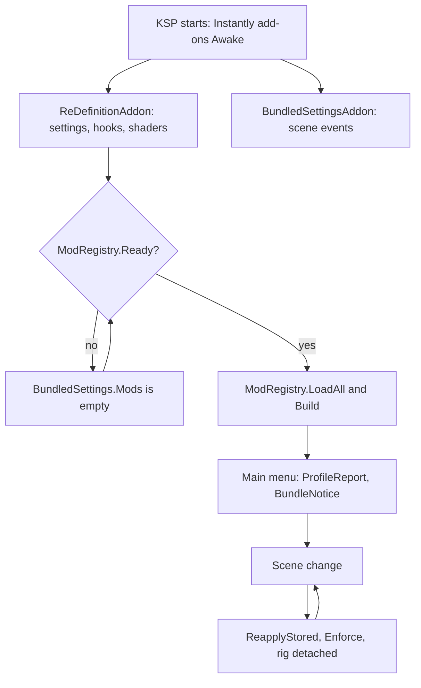

# Startup and scenes

**For:** a developer who debugs something that goes wrong at startup or after a scene change.
**You need:** the repository, and the `KSP.log` of one run to read the order of events in.
**You get:** the startup order, the add-on of every scene, and what a scene change takes away.

KSP starts ReDefinition as a set of add-ons, each tied to a scene. A few start with the game
and stay. Most start with one scene and are destroyed with it. Read this page to find the
add-on to open when a log line is missing at startup, or when something is gone after a scene
change.

## The order of startup

1. KSP creates every add-on marked `KSPAddon.Startup.Instantly` as the game starts, before any
   mod can be built. The table below lists them first.
2. `ReDefinitionAddon.Awake` in `src/ReDefinitionAddon.cs` calls `DontDestroyOnLoad`, sets
   `ReDefinitionAddon.Instance` and runs `ReDefinitionAddon.LoadSettings`. That reads
   `settings.cfg` (`OwnSettings.Load`) and `bundled.cfg` (the first ask of
   `BundledSettings.ProfileChosen`).
3. The same `Awake` installs the hooks into KSP and other mods, each in
   `ReDefinitionAddon.Guarded` so that one failure costs its own hook. It then registers the
   toolbar button and loads both shader sets with `ShaderBundle.Load`.
4. `BundledSettingsAddon.Awake` in `src/Settings/BundledSettingsAddon.cs` stays across scenes
   and subscribes to five `GameEvents`: `onGameSceneLoadRequested`, `onLevelWasLoaded`,
   `onLevelWasLoadedGUIReady`, `OnCameraChange` and `OnGameSettingsApplied`.
5. The other `Instantly` add-ons split in two. `ModWindowsAddon`, `LoadingScreenWindows`,
   `ScalingAddon`, `StageDetailsSetup`, `DashboardServer`, `PerfMonitor` and `GpuProfiler` stay
   with `DontDestroyOnLoad`. `KspSettingsSection`, `PauseMenuEntry`, `ReflectionProbeFix` and
   `ScreenCoordinates` install their Harmony patches in `Awake` and destroy themselves.
   `ToolbarHides`, `TimeWarpButton` and `FlightPanelHooks` do their work in `Awake` too.
6. While KSP loads, `ModRegistry.Ready` is false. It needs the `GameDatabase` and the
   `PartLoader`, which come after ModuleManager's patches. Until then `BundledSettings.Mods` is
   empty and `ProfileLibrary.LoadAll` reports "The game is still loading".
7. The first ask of `BundledSettings.Mods` after that builds the bundled mods:
   `ModRegistry.LoadAll` reads the registrations and `ModRegistry.Build` makes a
   `RegisteredMod` of each. `ProfileReport.Start` asks at the main menu if nothing has before.
8. At the main menu `BundleNotice` asks the player about new mods two seconds in, and
   `MainMenuEntry` adds the menu entry a frame after the menu starts.
9. No upscaler rig attaches in the main menu or its settings screen
   (`ReDefinitionAddon.OnlySettingsHere`). In every other scene `ReDefinitionAddon.Update`
   calls `ReDefinitionAddon.TryAttach` once a second.

## A scene change

1. `GameEvents.onGameSceneLoadRequested` runs `BundledSettingsAddon.OnSceneLoadRequested`. It
   hands the kept values to the mods and runs the queue of
   `BundledSettingsAddon.AtNextSceneChange`.
2. KSP destroys the old scene's add-ons and creates the new scene's.
3. `ReDefinitionAddon.Update` sees that `HighLogic.LoadedScene` changed. It calls
   `ReDefinitionAddon.Detach`, forgets the failures of the techniques that need not stand, and
   asks the proxy to retry its context (`FrameGenerationBridge.RetryContext`).
4. `onLevelWasLoaded` runs `BundledSettingsAddon.OnLevelLoaded`: `CatchUpProfile` once per run,
   `BundledSettings.ReapplyStored` and `Requirements.Enforce`. `ModWindowsAddon` calls
   `ModWindowClose.Forget` for the mods' windows of the old scene.
5. `onLevelWasLoadedGUIReady` repeats the hand-over and the enforcing, after the mods' own
   applies. `ModWindowsAddon` then calls `SettingsWindow.SceneChanged` and
   `ToolbarTakeover.Refresh`.

## The add-ons by scene

`once` is the second argument of `KSPAddon`. A class marked `once` has one instance for the
whole run.

| Class | File | Scene |
|---|---|---|
| `ReDefinitionAddon` | `src/ReDefinitionAddon.cs` | Instantly, once |
| `BundledSettingsAddon` | `src/Settings/BundledSettingsAddon.cs` | Instantly, once |
| `ModWindowsAddon` | `src/Window/ModWindowsAddon.cs` | Instantly, once |
| `KspSettingsSection` | `src/Window/KspSettingsSection.cs` | Instantly, once |
| `PauseMenuEntry` | `src/Window/PauseMenuEntry.cs` | Instantly, once |
| `ToolbarHides` | `src/Window/ToolbarHides.cs` | Instantly, once |
| `LoadingScreenWindows` | `src/Window/LoadingScreenWindows.cs` | Instantly, once |
| `ScalingAddon` | `src/Scaling/ScalingAddon.cs` | Instantly, once |
| `ScreenCoordinates` | `src/Upscaler/Rig/ScreenCoordinates.cs` | Instantly, once |
| `ReflectionProbeFix` | `src/Scenery/ReflectionProbeFix.cs` | Instantly, once |
| `DashboardServer` | `src/Dashboard/DashboardServer.cs` | Instantly, once |
| `FlightPanelHooks` | `src/Hud/Panel/FlightPanel.cs` | Instantly, once |
| `TimeWarpButton` | `src/Hud/TimeWarpButton.cs` | Instantly, once |
| `StageDetailsSetup` | `src/Hud/StageInfoColumns.cs` | Instantly, once |
| `PerfMonitor` | `src/Probe/PerfMonitor.cs` | Instantly, once |
| `GpuProfiler` | `src/Probe/GpuProfiler.cs` | Instantly, once |
| `ProfileReport` | `src/Settings/ProfileReport.cs` | MainMenu, once |
| `ProxyNotice` | `src/Window/ProxyNotice.cs` | MainMenu, once |
| `ForeignAssumptionReport` | `src/Diagnostics/ForeignAssumptionReport.cs` | MainMenu, once |
| `BundleNotice` | `src/Window/BundleNotice.cs` | MainMenu |
| `MainMenuEntry` | `src/Window/MainMenuEntry.cs` | MainMenu |
| `MenuFireworks` | `src/Menu/MenuFireworks.cs` | MainMenu |
| `KscArrivalMenu` | `src/Menu/KscArrival.cs` | MainMenu |
| `SceneProbeLauncher` | `src/Probe/SceneProbe.cs` | MainMenu |
| `SpaceCentreEntry` | `src/Hud/SpaceCentreButtons.cs` | SpaceCentre |
| `AssemblyAfterRecovery` | `src/Hud/AssemblyReturn.cs` | SpaceCentre |
| `TimeWarpBarSpaceCentre` | `src/Hud/TimeWarpBar.cs` | SpaceCentre |
| `SpaceCentreScaling` | `src/Scaling/SpaceCentreScaling.cs` | SpaceCentre |
| `KscArrivalDescent` | `src/Menu/KscArrival.cs` | SpaceCentre |
| `SceneProbeReturn` | `src/Probe/SceneProbe.cs` | SpaceCentre |
| `RunwayLights` | `src/Scenery/RunwayLights.cs` | FlightAndKSC |
| `KscGround` | `src/Scenery/KscGround.cs` | FlightAndKSC |
| `KscGrass` | `src/Scenery/KscGrass.cs` | FlightAndKSC |
| `KscButtons` | `src/Hud/KscButtons.cs` | FlightEditorAndKSC |
| `ProbeSwitchReset` | `src/Probe/ProbeSwitchReset.cs` | EveryScene |
| `SeaHighlights` | `src/Raytracing/Ksp/SeaHighlights.cs` | EveryScene |
| `FlightPanel` | `src/Hud/Panel/FlightPanel.cs` | Flight |
| `RoundGauge` | `src/Hud/RoundGauge.cs` | Flight |
| `NavballSpeeds` | `src/Hud/NavballSpeeds.cs` | Flight |
| `NavballDrag` | `src/Hud/NavballDrag.cs` | Flight |
| `NavballDockingMarker` | `src/Hud/NavballDockingMarker.cs` | Flight |
| `AutoAltimeter` | `src/Hud/AutoAltimeter.cs` | Flight |
| `FlightStartMode` | `src/Hud/FlightStartMode.cs` | Flight |
| `CrewSlotButtons` | `src/Hud/CrewSlotButtons.cs` | Flight |
| `SpaceCentreButtons` | `src/Hud/SpaceCentreButtons.cs` | Flight |
| `AssemblyReturn` | `src/Hud/AssemblyReturn.cs` | Flight |
| `TimeWarpBarFlight` | `src/Hud/TimeWarpBar.cs` | Flight |
| `HudTooltipsFlight` | `src/Hud/HudTooltips.cs` | Flight |
| `StageInfoColumnsFlight` | `src/Hud/StageInfoColumns.cs` | Flight |
| `DeltaVToolsFlight` | `src/Hud/DeltaVTools.cs` | Flight |
| `FlightScaling` | `src/Scaling/ScalingAddon.cs` | Flight |
| `MapNodeScaleFlight` | `src/Scaling/MapNodeScale.cs` | Flight |
| `FireflyIdle` | `src/Scenery/FireflyIdle.cs` | Flight |
| `MoonGlow` | `src/Raytracing/Ksp/MoonGlow.cs` | Flight |
| `RenderInterpolation` | `src/Upscaler/FrameGeneration/RenderInterpolation.cs` | Flight |
| `UnityMotionRepair` | `src/Upscaler/MotionVectors/UnityMotionRepair.cs` | Flight |
| `ModCost` | `src/Probe/ModCost.cs` | Flight |
| `SceneProbeRunner` | `src/Probe/SceneProbe.cs` | Flight |
| `EditorEngineer` | `src/Engineer/EditorEngineer.cs` | EditorAny |
| `EditorLaunchButton` | `src/Engineer/EditorLaunchButton.cs` | EditorAny |
| `HudTooltipsEditor` | `src/Hud/HudTooltips.cs` | EditorAny |
| `StageInfoColumnsEditor` | `src/Hud/StageInfoColumns.cs` | EditorAny |
| `DeltaVToolsEditor` | `src/Hud/DeltaVTools.cs` | EditorAny |
| `SceneProbeEditor` | `src/Probe/SceneProbe.cs` | EditorAny |
| `TrackingStationScaling` | `src/Scaling/ScalingAddon.cs` | TrackingStation |
| `MapNodeScaleTrackingStation` | `src/Scaling/MapNodeScale.cs` | TrackingStation |

## What does not survive a scene change

- The add-ons marked `Flight`, `SpaceCentre`, `EditorAny` and the other scenes. KSP destroys
  them with the scene, and their HUD objects go with them.
- The upscaler rig. `ReDefinitionAddon.Detach` tears it down and `TryAttach` builds a new one.
- The settings window. Its dialog's `onDestroy` handler in `SettingsWindow.Open` clears it.
- ReDefinition's record of the other mods' open windows (`ModWindowClose.Forget`).
- What a mod sets up anew per scene. That is why `ReapplyStored` runs three times per change.

Static state, Harmony patches and the add-ons with `DontDestroyOnLoad` last for the run.

## Where to change it

- A feature for one scene: add a `[KSPAddon]` class next to its files and a row to the table
  above.
- A value that a mod loses after a scene change: the handlers in `BundledSettingsAddon`
  (`OnLevelLoaded`, `OnLevelReady`) or the 2-second tick in `BundledSettingsAddon.Update`.
- A hook that must exist before any scene: `ReDefinitionAddon.Awake`, inside `Guarded`.

## What can go wrong

- A registration read too early gives an empty `BundledSettings.Mods`. `ProfileLibrary` says
  "The game is still loading", and `BundledSettings` logs "Mod registrations" with the
  problems.
- A follow-up queued before `BundledSettingsAddon` exists logs "A bundled setting's follow-up
  was queued with no add-on to run it".
- A missing shader set logs "Upscaler not operational"; a complete set logs "All eleven
  required compute shaders found".
- A rig that cannot start logs "Upscaler could not be set up yet, trying again in a second".
  After three failures it is not tried again before the next scene.
- A failed hook is a warning of its own kind, such as "ReDefinition's profile step failed this
  frame".
