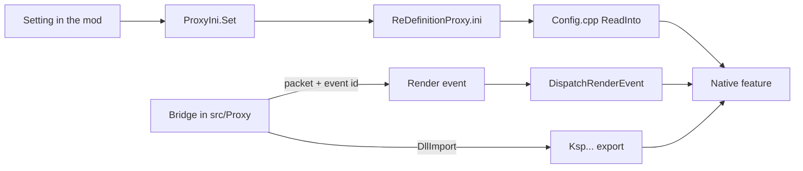

# Add a feature to the proxy

**For:** a developer who adds a native feature to the proxy and the mod code that drives it.
**You need:** the repository, CMake with the Visual Studio generator, and the Windows SDK.
**You get:** the list of files a native feature touches, in the order to edit them.

A proxy feature has a native half in `src/DxgiProxy` and a managed half in `src/Proxy`. The
two meet in three places: the exports, the render events and the `ReDefinitionProxy.ini` keys.
The worked example is the XeSS upscaler. It has a native class in
`src/DxgiProxy/Upscalers/XessUpscaler.cpp`, two events, four exports and a bridge in
`src/Proxy/XessUpscalerBridge.cs`.

## The steps

1. Put the source in the folder that fits: `SwapChain`, `FrameGeneration`, `Upscalers`,
   `Raytracing`, `Latency`, `Diagnostics`, `Managed` or `Common`. Name the files after the
   feature: `Upscalers/XessUpscaler.h` and `Upscalers/XessUpscaler.cpp`.
2. List every new file in `add_library(ReDefinitionProxy SHARED ...)` in
   `src/DxgiProxy/CMakeLists.txt`. The list is explicit, so an unlisted file is not built.
   A source includes headers by their plain names. A new folder also goes into
   `REDEFINITION_SOURCE_DIRS` in the same file.
3. Add a key to `src/DxgiProxy/ReDefinitionProxy.ini`, in the `[Proxy]` section, with a comment
   above it. The template is embedded in `dxgi.dll`, and `CompleteIni` in
   `src/DxgiProxy/Common/Config.cpp` adds the key to a player's file with its default.
4. Declare the key in `ProxyConfig` in `src/DxgiProxy/Common/Config.h` with its default. Read
   it in `ReadInto` in `Config.cpp` with `ReadFlag`, `ReadFloat` or `GetPrivateProfileIntW`,
   and clamp it. Add it to `Describe` in the same file, so that the log line shows it.
5. If the mod writes the key, call `ProxyIni.Set` in `src/Proxy/ProxyIni.cs` from the setting
   that owns it. `LowLatencySetting.Write` in `src/Settings/LowLatencySetting.cs` does so.
6. If the managed side calls into the feature, add an export to
   `src/DxgiProxy/Managed/ManagedBridge.cpp` with `__declspec(dllexport)`. Give it a name that
   starts with `Ksp`, such as `KspXessUpscalerReady`.
7. If the managed side hands the feature a frame, add a render event. Define
   `PX_EVENT_<NAME>` in `src/DxgiProxy/Managed/ProxyContract.h`. Add the constant `<Name>` to
   `ProxyEvents` in `src/Proxy/ProxyEvents.cs`. Add a branch to
   `DispatchRenderEvent` in `ManagedBridge.cpp`.
8. Write the bridge in `src/Proxy`. It imports the exports with `DllImport` and the name
   `ProxyDll.Name`. A frame packet is a `StructLayout` struct that implements `IRingPacket<T>`,
   and `PacketRing` keeps its slots. An upscaler uses `NativeUpscalerLink`, which probes the
   exports, compares the packet sizes and raises the events. The layer rule allows `Proxy` to
   use `Core` only.
9. Add the native packet as a struct with `static_assert` on its size and offsets, as
   `DlssPacket` has them in `src/DxgiProxy/Upscalers/Dlss.h`. Add a layout test for the managed
   struct in `tests/ReDefinition.Tests`, such as `DlssPacketLayoutTests`.
10. Add a check to the harness in `tests/DxgiProxy/ProxyHarness.cpp`, or to
    `tests/DxgiProxy/RaytracingHarness.cpp` for a raytracing feature. It sets the ini key
    through `IniKey`, runs the feature without the game and prints `PASS` or `FAIL`.
11. Document the key in `docs/reference/proxy-settings.md`. Build and check everything as
    [the build page](howto-build-and-check.md) lists.

## What holds the two sides together

* `ProxyContractTests.EveryEventIsTheContracts` reads `ProxyContract.h` and compares every
  `PX_EVENT_` define with a `ProxyEvents` constant. `ProxyContractTests.NoTwoEventsShareAnId`
  fails on a duplicate id.
* `RtContractTests` does the same for `src/DxgiProxy/Raytracing/Shaders/RtContract.h` and
  `RtNative`. The raytracing events are defined there, not in `ProxyContract.h`.
* `DlssPacketLayoutTests`, `FramePacketLayoutTests` and `RtFramePacketLayoutTests` check the
  size and offsets of the managed packets against the numbers in the native `static_assert`.
* `NativeUpscalerLink.Ready` compares the native packet size with the managed one at run time.
* `tools/checks/audit_ffx_fields.py` checks that every field of the FidelityFX frame generation
  descriptors is set or listed with a reason.

## Where to change it

* A new native source: its folder in `src/DxgiProxy` and the list in `CMakeLists.txt`.
* A new key: the template, `ProxyConfig`, `ReadInto` and `Describe`.
* A new call between the halves: `ManagedBridge.cpp` and the bridge in `src/Proxy`.

## What can go wrong

* A source is not in the list. The linker reports an unresolved symbol, or the feature is
  silently absent.
* The proxy is older than the mod. A missing export raises `EntryPointNotFoundException`, and
  `NativeUpscalerLink.Ready` reports that the proxy is not installed or older than the mod.
* The packet sizes differ. The log says `The dxgi.dll proxy and the mod disagree on the
  <name> packet`, and the feature stays off.
* An event throws on the render thread. `OnRenderEvent` in `ManagedBridge.cpp` drops it and
  logs `Render event <id> ended in an exception`, up to ten times.
* An ini value is out of range. `Config.cpp` logs a `Config: <key>=... is none of ...` line for
  the keys with named values, and clamps the numbers without a word.
* A key is missing from the template. `CompleteIni` cannot add it to a player's file, and the
  proxy falls back to the default in `ReadInto`.
* `enabled`, `allowTearing`, `measureOnly` and `frameGeneration` are read at the start only.
  `ReloadConfigIfChanged` keeps their old values and says so in `Config reloaded: ...`.
