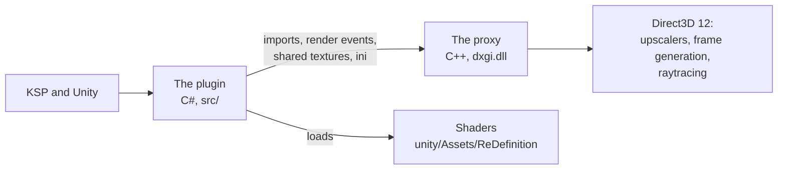

# Start here

**For:** a developer, or an AI that works on the code, who has just opened the repository.
**You need:** the repository.
**You get:** what ReDefinition is, where its parts live, what the code does not show you, and the
page for your job.

## What ReDefinition is

ReDefinition is a mod for Kerbal Space Program 1. For the player it is one settings window for the
graphics mods, profiles that set them up together, and rules that keep their settings compatible.
It adds upscaling with FSR, DLSS and XeSS, frame generation and raytracing, which work on the whole
scene, other mods' effects included. The [README](../../README.md) shows what a player gets.

For you, it is three programs in one process:

The plugin settles what to do and talks to KSP and the other mods. The proxy stands in for the
system's `dxgi.dll` and does the work that needs Direct3D 12. The shaders run in Unity. The data
the plugin reads, the registrations and profiles, is in `GameData/ReDefinition/`.

## What the code does not show you

* **Names in strings.** The compiler does not see a type or a file named in a string:
  reflection in `tools/checks/check_bundled_mods.ps1`, lookups of other mods' types, paths in
  tests. After you move or rename something, search for its name.
* **Layouts shared with the proxy.** A packet, a render event id or an ini key has two sides. The
  tests `ProxyContractTests` and `RtContractTests` hold them together. Change both sides in one commit.
* **Other mods' code is an assumption.** `src/Core/ForeignAssumptions.cs` lists each one, and
  `tools/checks/check_foreign_code.ps1` checks them against the installed build.
* **The game is the full test.** The unit tests and the proxy harnesses run without it. What the
  plugin does inside KSP shows only in `KSP.log`, where every line starts with the tag `[ReDefinition]`.
* **Layering.** `ArchitectureTests` holds which area may use which. A new dependency that is not in
  its table fails the tests.

## The job in front of you

| You want to | Open |
|---|---|
| Find your way around the code | [Architecture](architecture.md) |
| See what the game starts, and when | [Startup and scenes](flow-startup.md) |
| Change what happens to a frame in the mod | [A frame in the mod](flow-frame.md) |
| Change the proxy | [The proxy's present path](flow-proxy-present.md) and [add a feature to the proxy](howto-add-a-proxy-feature.md) |
| Change raytracing | [Raytracing from scene to screen](flow-raytracing.md) |
| Add or change a setting | [Add a setting](howto-add-a-setting.md) and [a setting's path](flow-setting.md) |
| Add a shader | [How shaders reach the game](flow-shaders.md) |
| Change a feature on screen | [The features on screen](flow-game-ui.md) |
| Change the dashboard | [The dashboard](flow-dashboard.md) |
| Change what other mods can call | [The interface for other mods](flow-mod-interface.md) |
| Understand how the plugin and the proxy exchange data | [The four channels to native code](flow-native-channels.md) |
| Build and check everything before a commit | [Build and check everything](howto-build-and-check.md) |
| Find a script | [The scripts in tools](tools-index.md) |
| Write a comment | [Writing code comments](writing-code-comments.md) |

Each folder under `src/` has a README with its start files and the rules that are true only there.

## Look things up in the wiki

The wiki generates these from the code, so they are always current:

| Index | It lists |
|---|---|
| [Entry points](https://github.com/CaptainKeyboard/ReDefinition/wiki/Index-entry-points) | Every add-on, by scene |
| [Harmony hooks](https://github.com/CaptainKeyboard/ReDefinition/wiki/Index-harmony-hooks) | Every patch of the game's or another mod's code |
| [Assumptions about other mods](https://github.com/CaptainKeyboard/ReDefinition/wiki/Index-foreign-assumptions) | What the code takes for granted |
| [Command-line switches](https://github.com/CaptainKeyboard/ReDefinition/wiki/Index-command-line-switches) | The probes and profilers |
| [Proxy ini keys](https://github.com/CaptainKeyboard/ReDefinition/wiki/Index-proxy-ini-keys) | The proxy's settings and their defaults |
| [Registrations](https://github.com/CaptainKeyboard/ReDefinition/wiki/Index-registrations) | The mods that register their settings |
| [Proxy exports](https://github.com/CaptainKeyboard/ReDefinition/wiki/Index-proxy-exports) | The functions the plugin calls in the proxy |
| [Dependencies](https://github.com/CaptainKeyboard/ReDefinition/wiki/Index-dependencies) | Which area uses which |

## The rules of the repository

* Code, comments, documentation and commit messages are in English.
* Commits follow Conventional Commits: `fix(upscaler): ...`, in the imperative, with the
  evidence in the body.
* Run [the checks](howto-build-and-check.md) before you commit. The unit tests include the check
  of the comments and of which area uses which.
